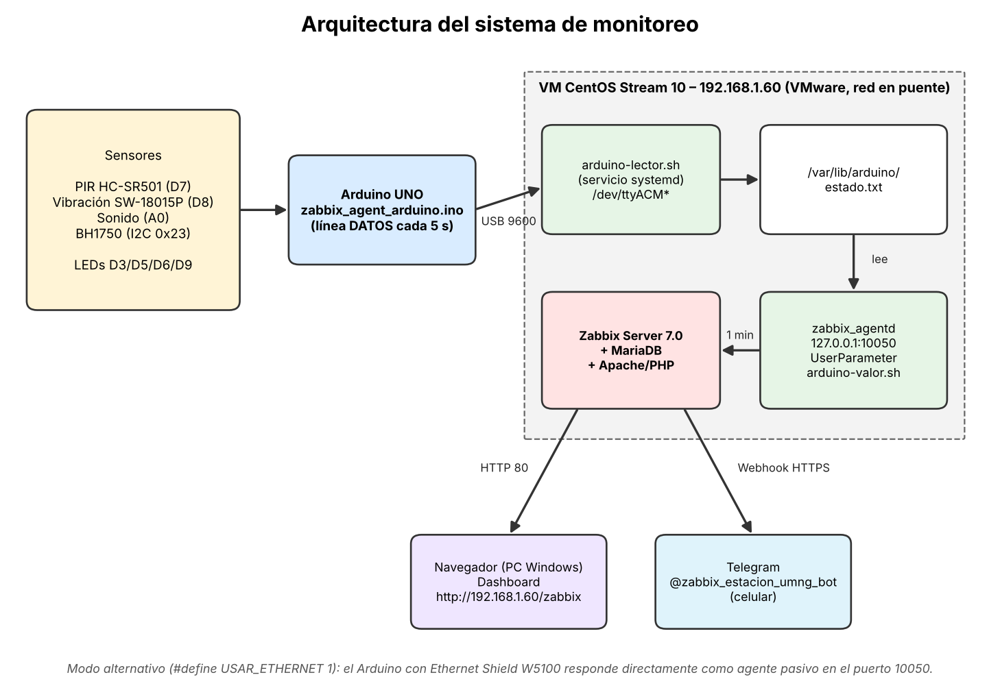
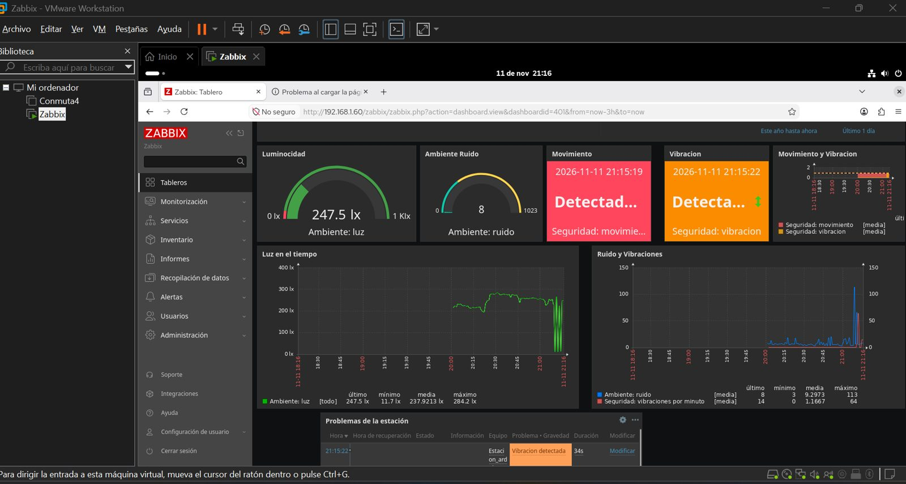
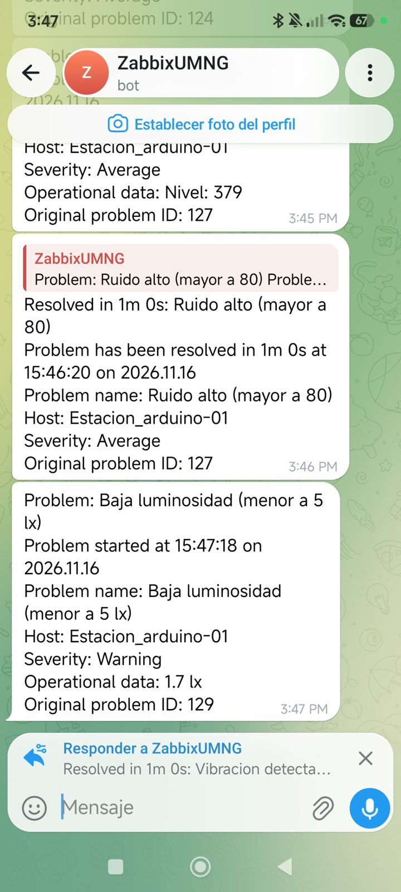

# Monitoreo de sensores Arduino con Zabbix y alertas por Telegram

Proyecto final de **Gestión de Redes** de la Universidad Militar Nueva Granada (UMNG).

Una estación de sensores con **Arduino UNO** (movimiento, vibración, ruido y luz) se integra con **Zabbix 7.0 LTS** sobre **CentOS Stream 10**. Zabbix guarda el historial, lo muestra en un tablero en tiempo real y envía alertas de problema y resolución a **Telegram**.



## Resultado

| Tablero en Zabbix | Alertas en Telegram |
|---|---|
|  |  |

## Componentes

| Capa | Tecnología |
|---|---|
| Sensores | PIR HC-SR501, SW-18015P, módulo de sonido, BH1750 y 4 LEDs indicadores |
| Controlador | Arduino UNO (modo USB; modo Ethernet W5100 opcional) |
| Servidor | VMware Workstation, CentOS Stream 10, Zabbix 7.0.32, MariaDB, Apache, PHP 8.4 |
| Integración | `arduino-lector` (systemd) y `UserParameter` del Zabbix Agent |
| Alertas | Webhook de Telegram, bot `@zabbix_estacion_umng_bot` |

## Plan de direccionamiento

| Equipo | IP | Puerto |
|---|---|---|
| Servidor Zabbix (VM, red en puente) | 192.168.1.60/24 | 80 (web), 10051 (servidor), 10050 (agente) |
| Puerta de enlace y DNS | 192.168.1.254 | — |
| Arduino (solo en modo Ethernet) | 192.168.1.50 | 10050 |

## Estructura del repositorio

```
├── README.md
├── docs/                      Documentación paso a paso
│   ├── 01-introduccion-teorica.md
│   ├── 02-servidor-zabbix-centos.md
│   ├── 03-montaje-hardware.md
│   ├── 04-programacion-arduino.md
│   ├── 05-puente-usb-agente.md
│   ├── 06-plantilla-y-dashboard.md
│   ├── 07-alertas-telegram.md
│   ├── 08-resultados-y-analisis.md
│   ├── 09-bitacora-incidentes.md
│   └── 10-conclusiones.md
├── firmware/zabbix_agent_arduino/zabbix_agent_arduino.ino
├── centos/                    Puente USB → Zabbix Agent
│   ├── arduino-lector.sh
│   ├── arduino-lector.service
│   ├── arduino-valor.sh
│   └── arduino.conf
├── zabbix/plantilla_estacion_arduino.yaml
├── esquematicos/              Arquitectura y conexiones
├── evidencias/                Capturas numeradas en orden del proceso
└── datasheets/README.md       Hojas de datos y referencias
```

## Inicio rápido

1. **Servidor:** instalar Zabbix 7.0 en CentOS Stream 10 siguiendo [docs/02](docs/02-servidor-zabbix-centos.md).
2. **Hardware:** armar el circuito de [docs/03](docs/03-montaje-hardware.md).
3. **Firmware:** cargar `firmware/zabbix_agent_arduino/zabbix_agent_arduino.ino` con `USAR_ETHERNET 0`.
4. **Puente USB:** conectar el Arduino a la VM y ejecutar:
   ```bash
   sudo install -m 755 centos/arduino-lector.sh centos/arduino-valor.sh /usr/local/bin/
   sudo install -m 644 centos/arduino-lector.service /etc/systemd/system/
   sudo install -m 644 centos/arduino.conf /etc/zabbix/zabbix_agentd.d/
   sudo semanage permissive -a zabbix_agent_t
   sudo systemctl daemon-reload && sudo systemctl enable --now arduino-lector
   sudo systemctl restart zabbix-agent
   zabbix_get -s 127.0.0.1 -k sensor.luz
   ```
5. **Zabbix:** importar `zabbix/plantilla_estacion_arduino.yaml` y crear el equipo con interfaz de agente `127.0.0.1:10050` ([docs/06](docs/06-plantilla-y-dashboard.md)).
6. **Telegram:** crear el bot, configurar el tipo de medio, el medio del usuario y la acción ([docs/07](docs/07-alertas-telegram.md)).

## Métricas e iniciadores

| Clave | Iniciador | Gravedad |
|---|---|---|
| `sensor.uptime` | Estacion sin datos por 3m / Estacion reiniciada | Alta / Info |
| `sensor.luz` | Baja luminosidad (< 5 lx) / Cambio brusco de luz (> 30 lx) | Advertencia |
| `sensor.movimiento` | Movimiento detectado | Advertencia |
| `sensor.vibracion` | Vibracion detectada | Media |
| `sensor.vibraciones` | (gráfico de vibraciones por minuto) | — |
| `sensor.ruido` | Ruido alto (> 80) | Media |

## Seguridad

Este repositorio **no contiene** el token del bot de Telegram ni las contraseñas de la base de datos o del usuario Admin. Antes de publicar capturas, verifica que no muestren el campo `api_token`.

## Créditos

- Firmware basado en [Arduino-Zabbix-Agent](https://github.com/interlegis/Arduino-Zabbix-Agent) de Interlegis (GPL v2), adaptado a Zabbix 7.0 y a los sensores de este proyecto.
- Docente: Ing. Jaider Ospina Navas, Gestión de Redes, UMNG.
