# 2. Instalación del servidor Zabbix en CentOS Stream 10

Esta sección explica cómo se preparó el servidor que recibe y procesa los datos: una máquina virtual con **CentOS Stream 10** en **VMware Workstation**, con Zabbix 7.0 LTS, MariaDB y Apache.

## Paso 2.1 – Identificar el sistema operativo

El primer intento con los comandos de una guía para Ubuntu (`apt`) falló: CentOS usa el gestor de paquetes **dnf**.

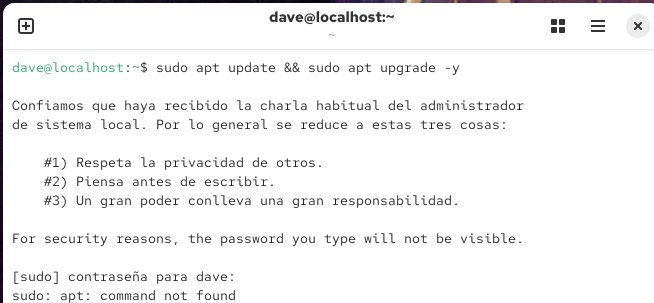

Se verificó la versión exacta del sistema y que corre sobre VMware:

```bash
cat /etc/os-release
systemd-detect-virt
```

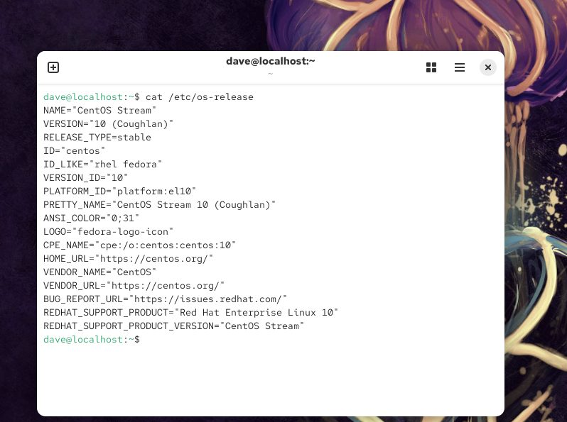


**Resultado:** CentOS Stream 10, virtualizado en `vmware`. Desde aquí toda la guía usa `dnf`, `firewalld` y SELinux.

## Paso 2.2 – Configurar la red de la máquina virtual

Para que el servidor tenga una IP de la red del laboratorio, el adaptador de la VM se configuró en **modo puente (Bridged)**, con la casilla **Conectado** marcada.

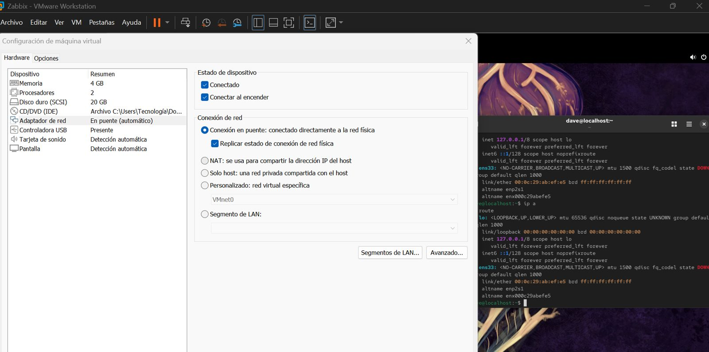

La interfaz aparecía `NO-CARRIER` (el adaptador virtual estaba desconectado). Se resolvió en VMware y luego se activó la conexión:

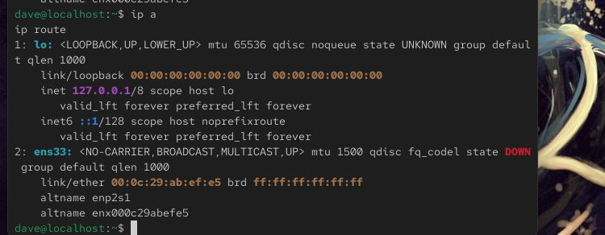

```bash
sudo nmcli device connect ens33
ip a show ens33
```

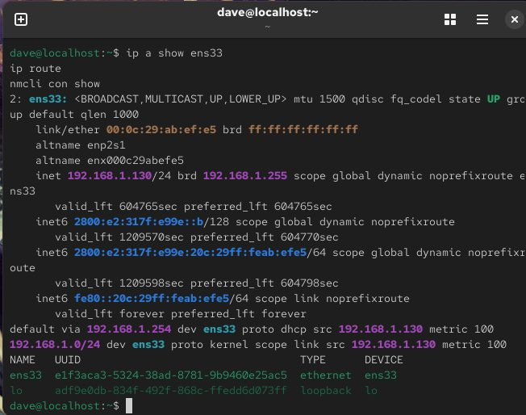

Después se fijó una **IP estática**, para que la dirección del servidor no cambie:

```bash
sudo nmcli con mod ens33 ipv4.method manual \
  ipv4.addresses 192.168.1.60/24 ipv4.gateway 192.168.1.254 ipv4.dns 192.168.1.254
sudo nmcli con up ens33
ping -c 3 8.8.8.8
```

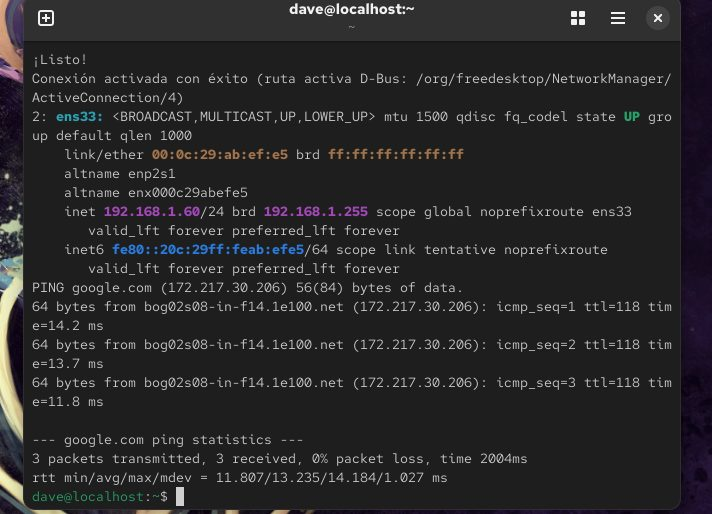

| Parámetro | Valor |
|---|---|
| Interfaz | ens33 |
| IP del servidor | 192.168.1.60/24 |
| Puerta de enlace y DNS | 192.168.1.254 |

## Paso 2.3 – Instalar el repositorio de Zabbix 7.0

La primera ruta probada (`.../centos/10/...`) devolvió **404**. Zabbix publica los paquetes para la familia RHEL 10 en la ruta `rhel/10`:

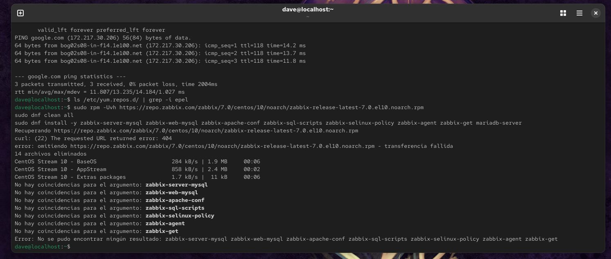

```bash
sudo dnf install -y https://repo.zabbix.com/zabbix/7.0/rhel/10/x86_64/zabbix-release-latest-7.0.el10.noarch.rpm
sudo dnf clean all
```

## Paso 2.4 – Instalar paquetes

```bash
sudo dnf install -y zabbix-server-mysql zabbix-web-mysql zabbix-apache-conf \
  zabbix-sql-scripts zabbix-selinux-policy zabbix-agent zabbix-get mariadb-server
```

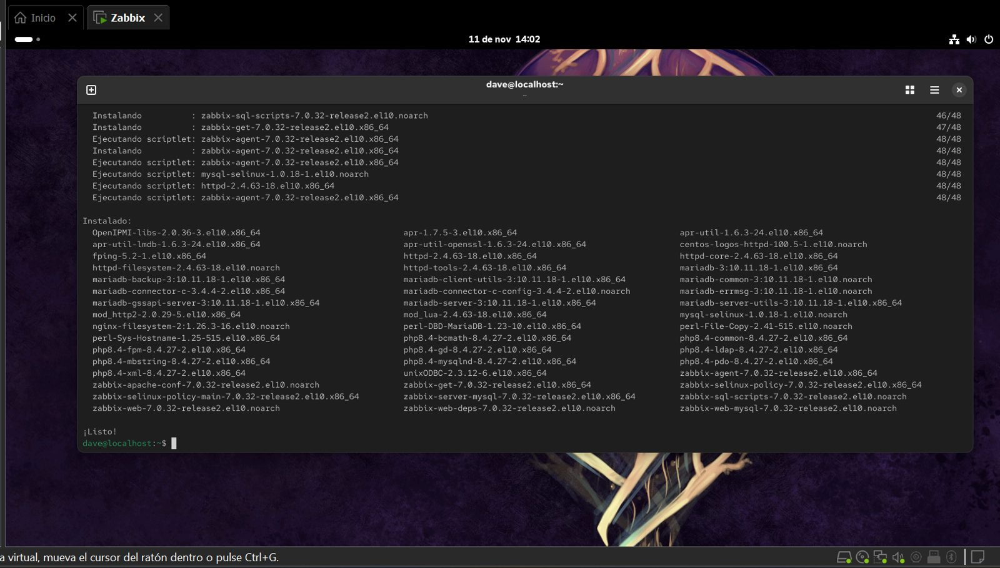

## Paso 2.5 – Base de datos MariaDB

```bash
sudo systemctl enable --now mariadb
sudo mysql_secure_installation
sudo mysql -uroot -p
```

```sql
CREATE DATABASE zabbix CHARACTER SET utf8mb4 COLLATE utf8mb4_bin;
CREATE USER zabbix@localhost IDENTIFIED BY '<CONTRASEÑA_BD>';
GRANT ALL PRIVILEGES ON zabbix.* TO zabbix@localhost;
SET GLOBAL log_bin_trust_function_creators = 1;
QUIT;
```

Importación del esquema inicial (tarda unos minutos):

```bash
zcat /usr/share/zabbix-sql-scripts/mysql/server.sql.gz | \
  mysql --default-character-set=utf8mb4 -uzabbix -p zabbix
sudo mysql -uroot -p -e "SET GLOBAL log_bin_trust_function_creators = 0;"
```

En `/etc/zabbix/zabbix_server.conf` se define la contraseña de la base de datos:

```ini
DBPassword=<CONTRASEÑA_BD>
```

> Por seguridad, las contraseñas reales no aparecen en este documento ni en el repositorio.

## Paso 2.6 – SELinux y firewall

```bash
sudo setsebool -P httpd_can_connect_zabbix on
sudo setsebool -P httpd_can_network_connect_db on
sudo setsebool -P zabbix_can_network on

sudo firewall-cmd --permanent --add-service=http
sudo firewall-cmd --permanent --add-port=10051/tcp
sudo firewall-cmd --reload
```

## Paso 2.7 – Iniciar servicios

```bash
sudo systemctl enable --now zabbix-server zabbix-agent httpd php-fpm
sudo systemctl status zabbix-server
```

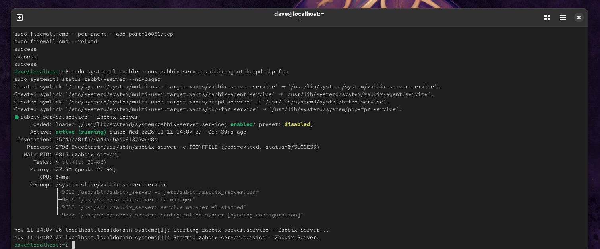

## Paso 2.8 – Asistente web

Desde el navegador del PC, en `http://192.168.1.60/zabbix`, se completó el asistente: idioma español, conexión a la BD `zabbix` con el usuario `zabbix`, nombre del servidor y zona horaria **America/Bogota**.

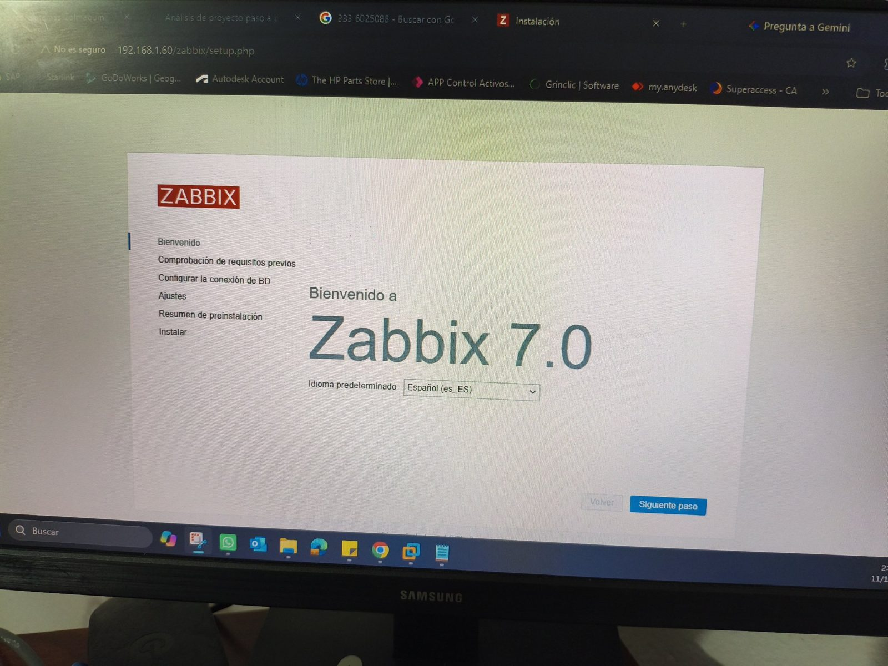

Al terminar se ingresó con el usuario por defecto `Admin` y se vio el tablero global:

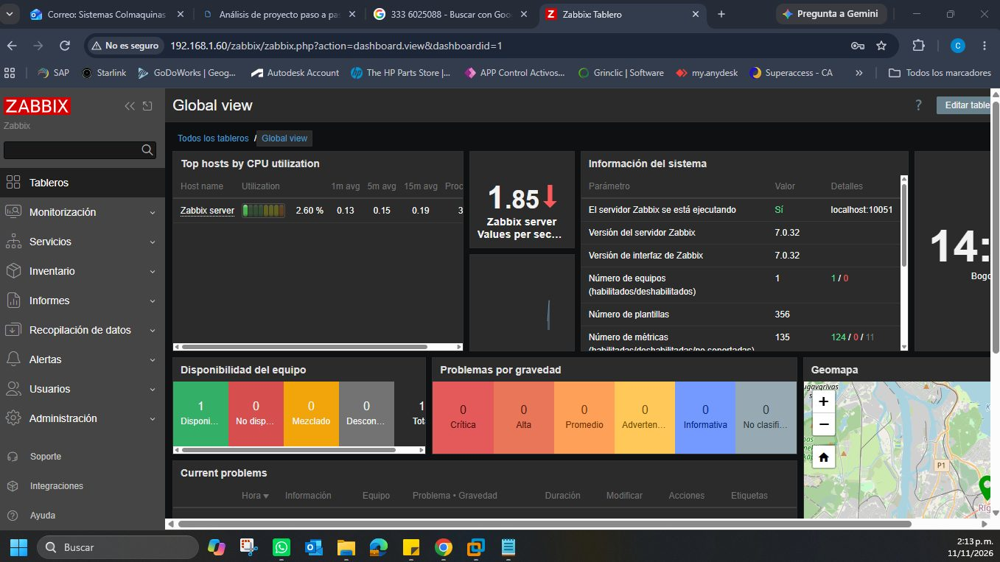

## Paso 2.9 – Cambiar la contraseña del administrador

En **Usuarios → Usuarios → Admin → Cambiar la contraseña** se reemplazó la contraseña por defecto (`zabbix`) por una propia.

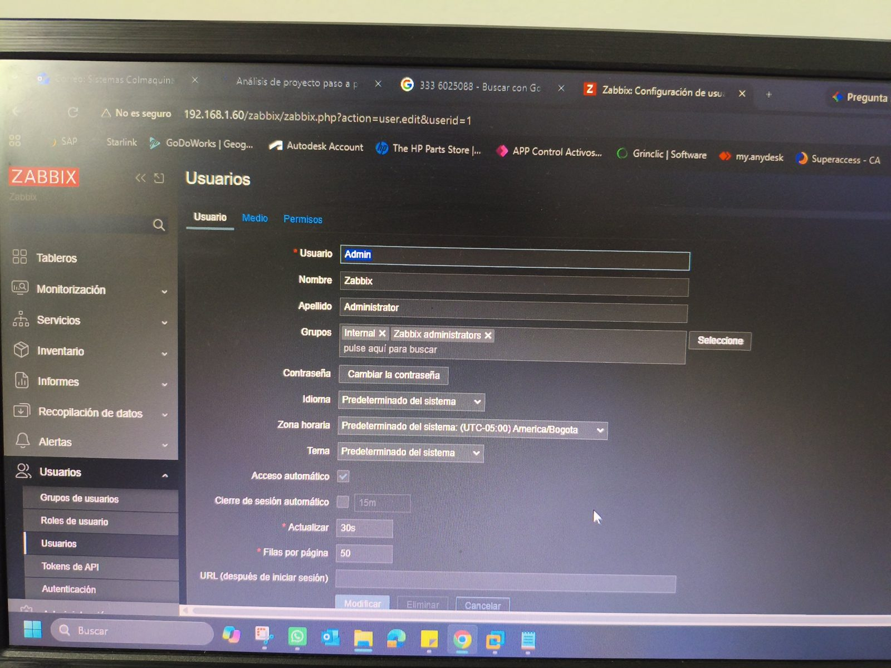

**Resultado de la fase:** el servidor Zabbix 7.0.32 queda operativo en `192.168.1.60`, accesible desde la red del laboratorio.
