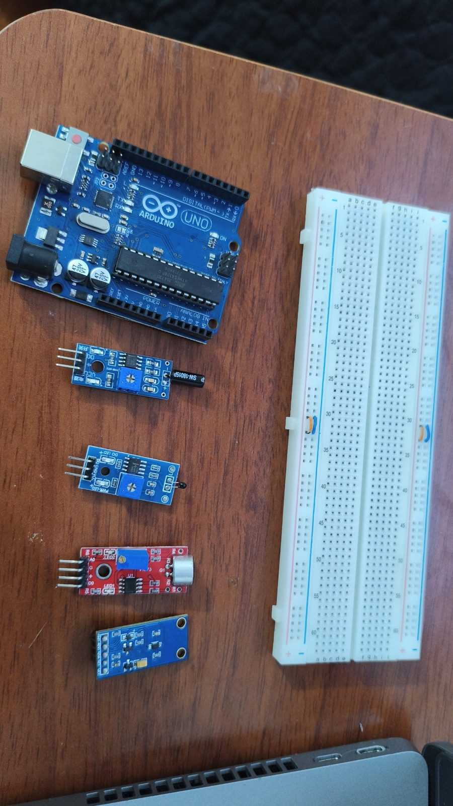
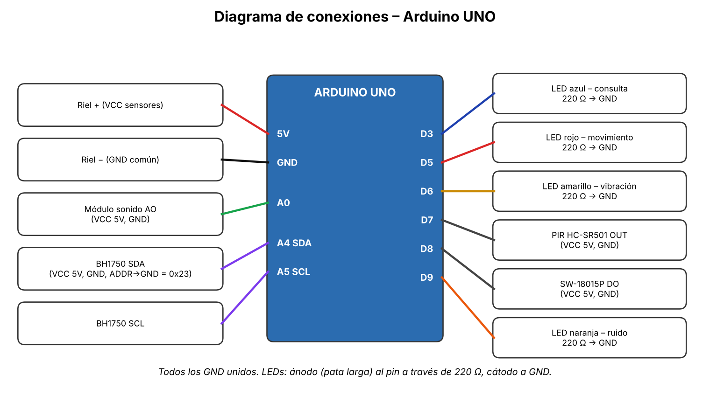
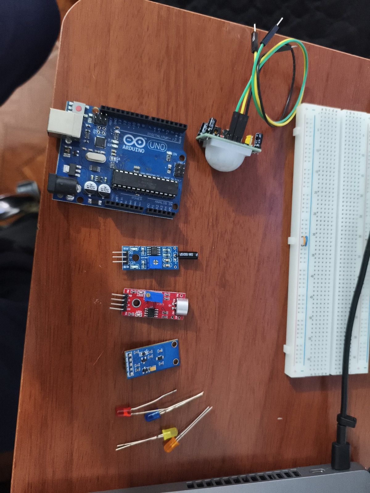
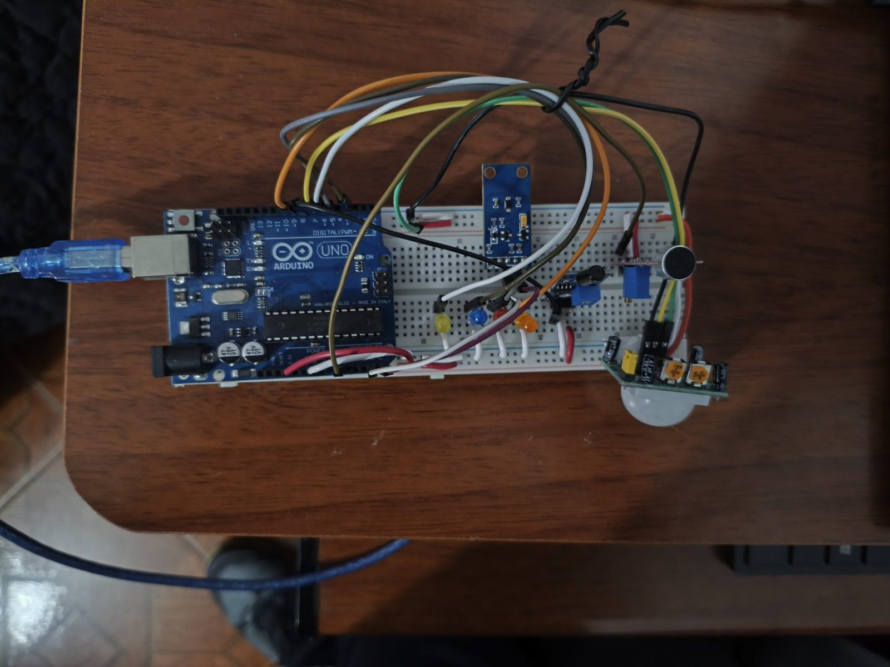

# 3. Montaje del hardware

## Paso 3.1 – Inventario de sensores

Se revisaron los sensores disponibles en el kit. El DHT11 se dejó por fuera, con aprobación del docente, y se usaron cuatro sensores que cubren variables distintas: movimiento, vibración, sonido y luz.

## Paso 3.2 – Lista de materiales

| Cant. | Elemento | Uso |
|---|---|---|
| 1 | Arduino UNO R3 y cable USB | Controlador |
| 1 | Sensor PIR HC-SR501 | Movimiento |
| 1 | Módulo de vibración SW-18015P | Golpes y vibración |
| 1 | Módulo de sonido con micrófono (salida AO) | Nivel de ruido |
| 1 | Sensor de luz BH1750 (GY-302) | Iluminancia en lux |
| 4 | LED (azul, rojo, amarillo, naranja) | Indicadores locales |
| 4 | Resistencias de 220 Ω | Limitar la corriente de los LED |
| 1 | Protoboard y cables dupont | Montaje |
| 1 | Ethernet Shield W5100 (opcional) | Modo Ethernet |

## Paso 3.3 – Asignación de pines

| Elemento | Pin Arduino | Alimentación |
|---|---|---|
| PIR HC-SR501 – OUT | D7 | 5 V / GND |
| SW-18015P – DO | D8 | 5 V / GND |
| Sonido – AO | A0 | 5 V / GND |
| BH1750 – SDA / SCL | A4 / A5 | 5 V / GND (ADDR a GND → 0x23) |
| LED azul (consulta o envío) | D3 + 220 Ω | — |
| LED rojo (movimiento) | D5 + 220 Ω | — |
| LED amarillo (vibración) | D6 + 220 Ω | — |
| LED naranja (ruido alto) | D9 + 220 Ω | — |

Los pines **D4 y D10 a D13** se dejaron libres a propósito porque los usa el Ethernet Shield W5100 (SPI y lector SD). Así el mismo montaje funciona en los dos modos.

## Paso 3.4 – Armado

1. Se unieron los rieles de 5 V y GND de la protoboard con el Arduino. **Todos los GND quedan comunes.**
2. Se conectaron los sensores digitales (PIR en D7, vibración en D8).
3. Se conectó la salida analógica del módulo de sonido a A0.
4. Se conectó el BH1750 al bus I2C (SDA a A4, SCL a A5).
5. Se colocaron los LED con su resistencia de 220 Ω en serie: ánodo (pata larga) hacia el pin y cátodo a GND.

### Ajustes del PIR HC-SR501

- **Potenciómetro Sx (sensibilidad):** define el alcance, entre unos 3 y 7 m.
- **Potenciómetro Tx (tiempo):** define cuánto se mantiene la salida en alto, entre unos 3 s y 5 min. Se recomienda dejarlo al **mínimo**, porque el firmware ya mantiene el evento 60 s.
- **Jumper H/L:** `H` (disparo repetitivo) mantiene la salida activa mientras haya movimiento.
- Tras energizarlo, necesita **30 a 60 s de calibración**, durante los cuales puede dar falsos positivos.
