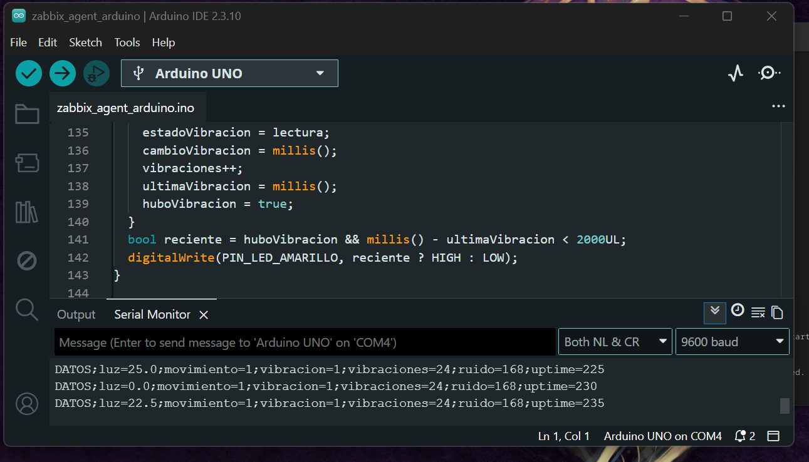

# 4. Programación del Arduino

Código completo: [`firmware/zabbix_agent_arduino/zabbix_agent_arduino.ino`](../firmware/zabbix_agent_arduino/zabbix_agent_arduino.ino)

El programa se basa en el proyecto **Arduino-Zabbix-Agent de Interlegis** (GPL v2), que se adaptó a los sensores del proyecto y al protocolo de Zabbix 7.0.

## Paso 4.1 – Modos de funcionamiento

```cpp
#define USAR_ETHERNET 0   // 0 = USB, 1 = Ethernet Shield W5100
```

| Modo | Funcionamiento | Flash | RAM |
|---|---|---|---|
| **USB (0)**, el usado | Cada 5 s envía por serie una línea `DATOS;luz=…;movimiento=…;…` | 8 994 B (27,4 %) | 534 B (26,1 %) |
| **Ethernet (1)** | Responde como agente pasivo en TCP 10050 (cabecera `ZBXD` y JSON de 7.0), solo a la IP 192.168.1.60 | 22 874 B (69,8 %) | 1 065 B (52 %) |

## Paso 4.2 – Claves que publica

| Clave | Descripción | Unidad o rango |
|---|---|---|
| `sensor.luz` | Iluminancia del BH1750 | lx |
| `sensor.movimiento` | 1 si el PIR detectó movimiento en los últimos 60 s | 0 / 1 |
| `sensor.vibracion` | 1 si hubo vibración en los últimos 60 s | 0 / 1 |
| `sensor.vibraciones` | Contador total de vibraciones desde el encendido | conteo |
| `sensor.ruido` | Pico de ruido (pico a pico) de los últimos 30 a 60 s | 0 a 1023 |
| `sensor.uptime` | Segundos desde el encendido | s |

En modo Ethernet también responde `agent.ping` y `agent.version`.

## Paso 4.3 – Lógica de cada sensor

- **Movimiento y vibración: "retención" de 60 s.** Zabbix consulta cada minuto, así que un evento breve podría perderse entre dos consultas. Por eso el firmware mantiene el valor en 1 durante 60 s después del último evento.
- **Vibración:** cuenta flancos con un **antirrebote de 50 ms** para no sumar varios pulsos de un mismo golpe.
- **Ruido:** cada 20 ms calcula la amplitud **pico a pico** de la señal del micrófono. Conserva el máximo de bloques de 30 s, de modo que el valor reportado es el pico de los últimos 30 a 60 s. Con un pico mayor a 200 enciende el LED naranja.
- **Luz:** lee el BH1750 cada segundo en modo de alta resolución, directamente con `Wire` sin librerías externas: valor bruto ÷ 1,2 = lux.
- **LEDs:** azul al enviar datos o responder a Zabbix, rojo con movimiento, amarillo con vibración, naranja con ruido alto.

## Paso 4.4 – Cargar y probar

1. Abrir el `.ino` en el IDE de Arduino, seleccionar **Arduino UNO** y el puerto COM.
2. Compilar y cargar.
3. Abrir el **Monitor Serie a 9600 baudios** y comprobar que cada 5 s aparece una línea como esta:

```
DATOS;luz=18.3;movimiento=0;vibracion=0;vibraciones=4;ruido=37;uptime=125
```



**Resultado:** al mover la mano frente al PIR, golpear la mesa o hablar cerca del micrófono, los valores cambian y se encienden los LED correspondientes.

> **Importante:** cierra el Monitor Serie antes de conectar el Arduino a la VM. Un puerto serie solo puede abrirlo un programa a la vez.
