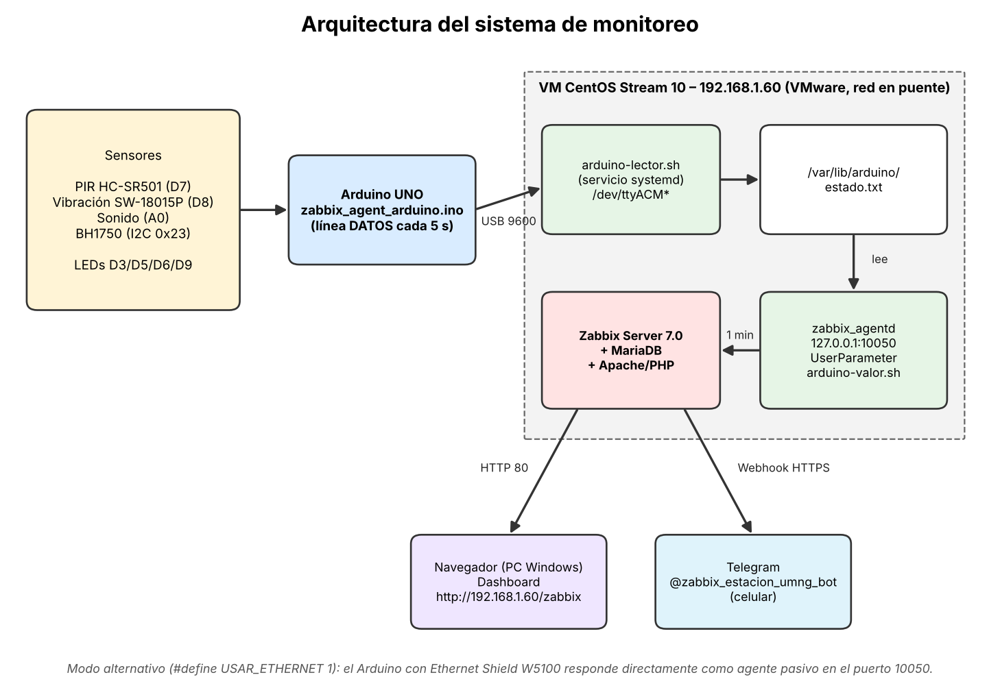
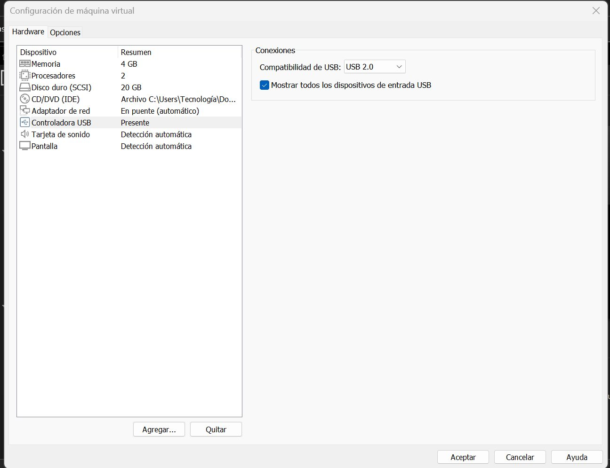
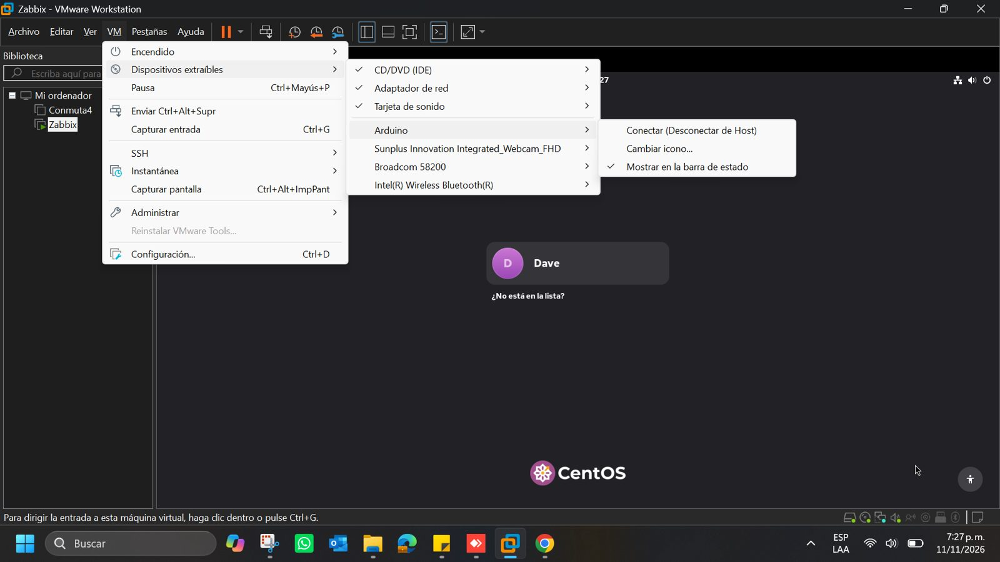
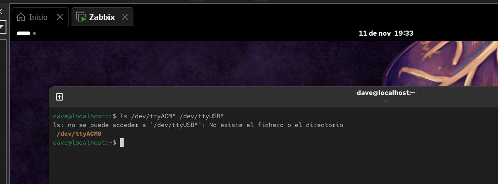
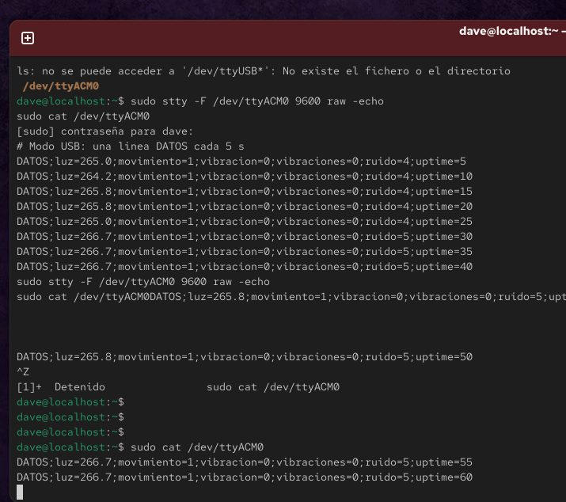
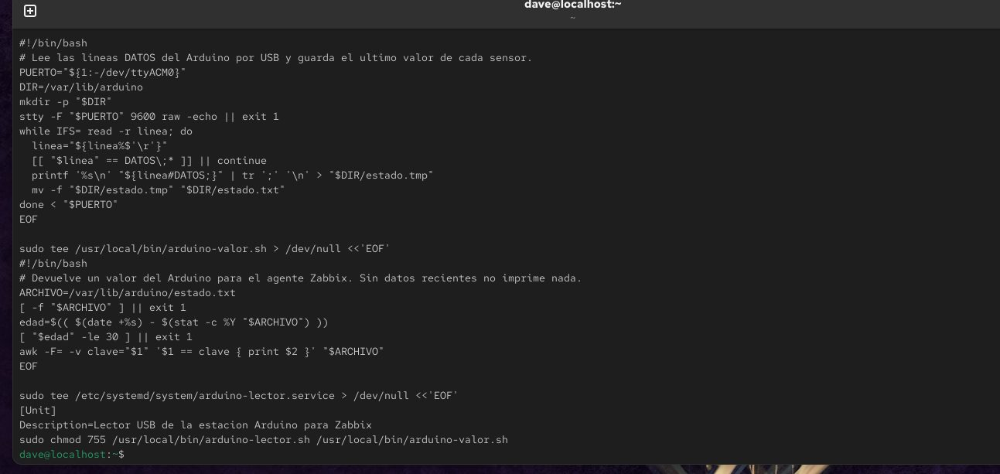
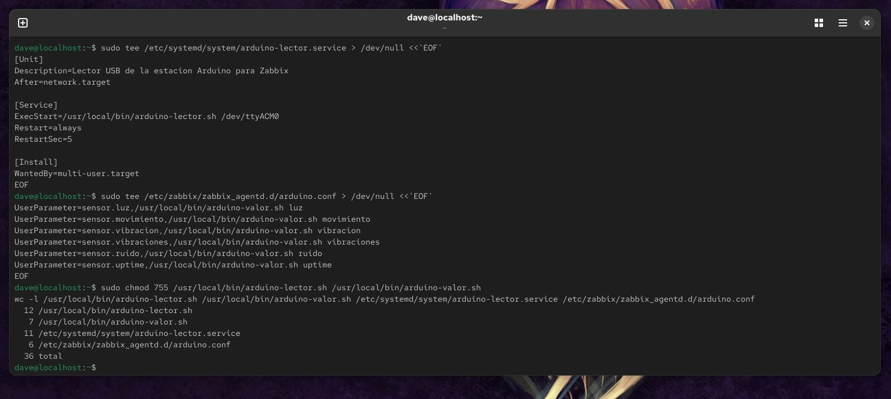
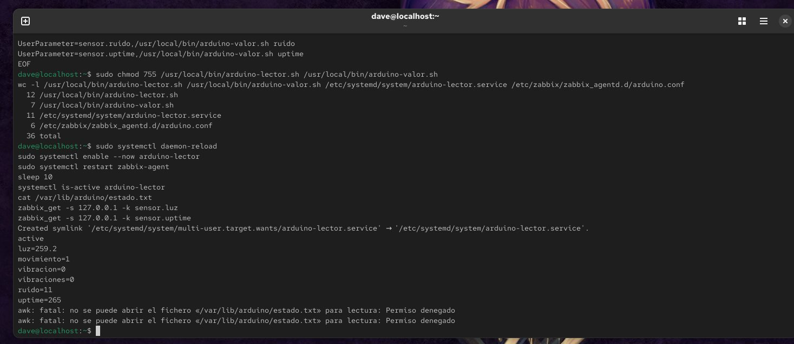
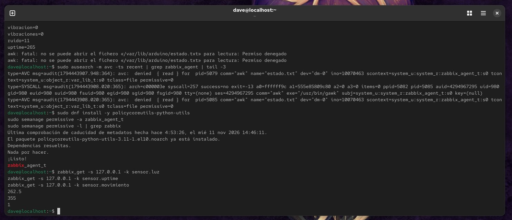
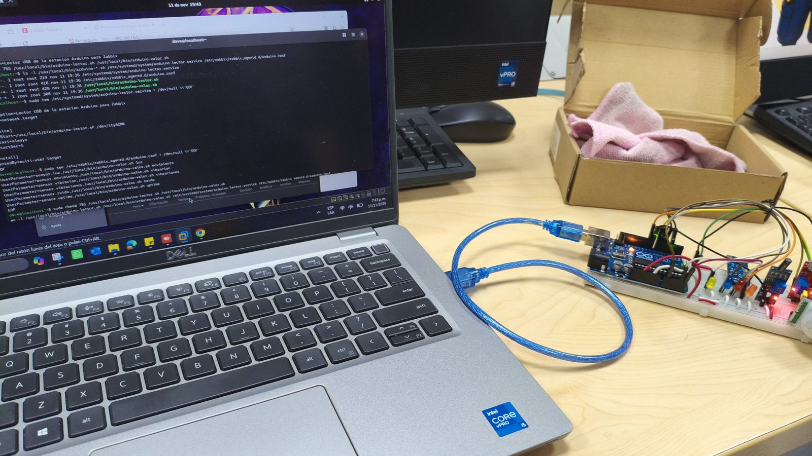

# 5. Puente USB: del Arduino al agente Zabbix

En lugar del Ethernet Shield se usó la alternativa aprobada por el docente: el Arduino se conecta por USB a la máquina virtual y el agente Zabbix local publica sus datos.

```
Arduino --USB--> arduino-lector.sh --> /var/lib/arduino/estado.txt --> arduino-valor.sh --> zabbix_agentd (127.0.0.1:10050) --> Zabbix Server
```



## Paso 5.1 – Pasar el Arduino a la VM

1. En VMware, en **VM → Settings**, comprobar que exista un **USB Controller** (compatibilidad USB 2.0/3.x).
2. Con la VM encendida, ir a **VM → Removable Devices → Arduino UNO → Connect (Disconnect from host)**.




3. En CentOS, verificar que el dispositivo aparece:

```bash
ls -l /dev/ttyACM*
```



4. Verificar que llegan los datos (Ctrl+C para salir):

```bash
sudo stty -F /dev/ttyACM0 9600 raw -echo
sudo cat /dev/ttyACM0
```



## Paso 5.2 – Script lector (servicio)

[`centos/arduino-lector.sh`](../centos/arduino-lector.sh) lee el puerto serie y, por cada línea `DATOS`, reescribe `/var/lib/arduino/estado.txt` con un valor por línea (`clave=valor`). La escritura es atómica (`.tmp` y luego `mv`) para que el agente nunca lea un archivo a medio escribir.

```bash
#!/bin/bash
# Lee las lineas DATOS del Arduino por USB y guarda el ultimo valor de cada sensor.
PUERTO="${1:-$(ls /dev/ttyACM* /dev/ttyUSB* 2>/dev/null | head -1)}"
DIR=/var/lib/arduino
mkdir -p "$DIR"
stty -F "$PUERTO" 9600 raw -echo || exit 1
while IFS= read -r linea; do
  linea="${linea%$'\r'}"
  [[ "$linea" == DATOS\;* ]] || continue
  printf '%s\n' "${linea#DATOS;}" | tr ';' '\n' > "$DIR/estado.tmp"
  mv -f "$DIR/estado.tmp" "$DIR/estado.txt"
done < "$PUERTO"
```

> El puerto se **detecta automáticamente**. Esta mejora surgió del incidente del 16 de noviembre, cuando el Arduino reapareció como `ttyACM1` (ver la [bitácora](09-bitacora-incidentes.md)).

## Paso 5.3 – Script de consulta

[`centos/arduino-valor.sh`](../centos/arduino-valor.sh) devuelve el valor de una clave. Si el archivo tiene más de 30 s, no devuelve nada, y Zabbix detecta así la falta de datos.

```bash
#!/bin/bash
ARCHIVO=/var/lib/arduino/estado.txt
[ -f "$ARCHIVO" ] || exit 1
edad=$(( $(date +%s) - $(stat -c %Y "$ARCHIVO") ))
[ "$edad" -le 30 ] || exit 1
awk -F= -v clave="$1" '$1 == clave { print $2 }' "$ARCHIVO"
```

## Paso 5.4 – UserParameter del agente

[`centos/arduino.conf`](../centos/arduino.conf) va en `/etc/zabbix/zabbix_agentd.d/`:

```ini
UserParameter=sensor.luz,/usr/local/bin/arduino-valor.sh luz
UserParameter=sensor.movimiento,/usr/local/bin/arduino-valor.sh movimiento
UserParameter=sensor.vibracion,/usr/local/bin/arduino-valor.sh vibracion
UserParameter=sensor.vibraciones,/usr/local/bin/arduino-valor.sh vibraciones
UserParameter=sensor.ruido,/usr/local/bin/arduino-valor.sh ruido
UserParameter=sensor.uptime,/usr/local/bin/arduino-valor.sh uptime
```

## Paso 5.5 – Instalación de los archivos

Al pegar heredocs largos en la terminal, el texto llegó **truncado**:



Por eso cada archivo se pegó por separado y se verificó con `wc -l`. Los valores correctos son **12 / 7 / 11 / 6** líneas (o se copian los archivos del repositorio con `scp`).

```bash
sudo install -m 755 arduino-lector.sh arduino-valor.sh /usr/local/bin/
sudo install -m 644 arduino-lector.service /etc/systemd/system/
sudo install -m 644 arduino.conf /etc/zabbix/zabbix_agentd.d/
wc -l /usr/local/bin/arduino-*.sh /etc/systemd/system/arduino-lector.service /etc/zabbix/zabbix_agentd.d/arduino.conf

sudo systemctl daemon-reload
sudo systemctl enable --now arduino-lector
sudo systemctl restart zabbix-agent
cat /var/lib/arduino/estado.txt
```



Contenido de [`centos/arduino-lector.service`](../centos/arduino-lector.service):

```ini
[Unit]
Description=Lector USB de la estacion Arduino para Zabbix
After=network.target

[Service]
ExecStart=/usr/local/bin/arduino-lector.sh
Restart=always
RestartSec=5

[Install]
WantedBy=multi-user.target
```

## Paso 5.6 – SELinux y verificación con zabbix_get

La primera prueba devolvió **"Permiso denegado"**: SELinux impedía que el agente (dominio `zabbix_agent_t`) ejecutara los scripts y leyera `/var/lib/arduino`.



Se revisó el registro de auditoría y se dejó **solo el dominio del agente** en modo permisivo. SELinux sigue en modo *enforcing* para el resto del sistema:

```bash
sudo ausearch -m avc -ts recent | tail
sudo semanage permissive -a zabbix_agent_t
sudo systemctl restart zabbix-agent

zabbix_get -s 127.0.0.1 -k sensor.luz
zabbix_get -s 127.0.0.1 -k sensor.uptime
```



**Resultado:** `zabbix_get` devuelve los valores reales de los sensores y el puente queda funcionando.


