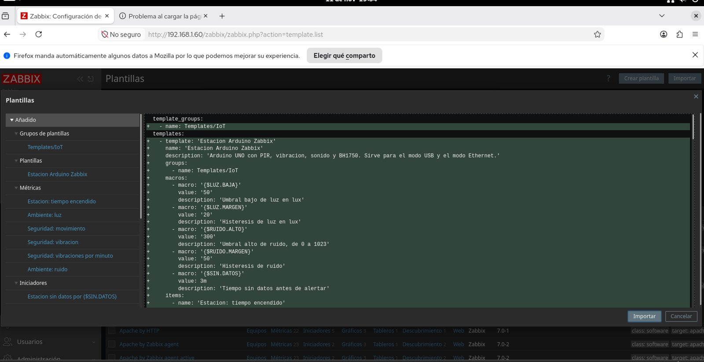
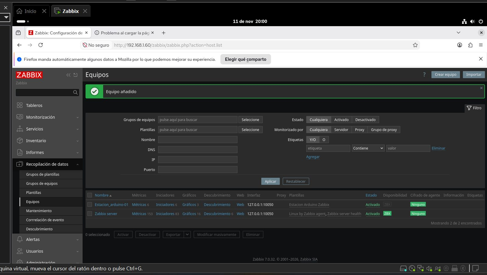
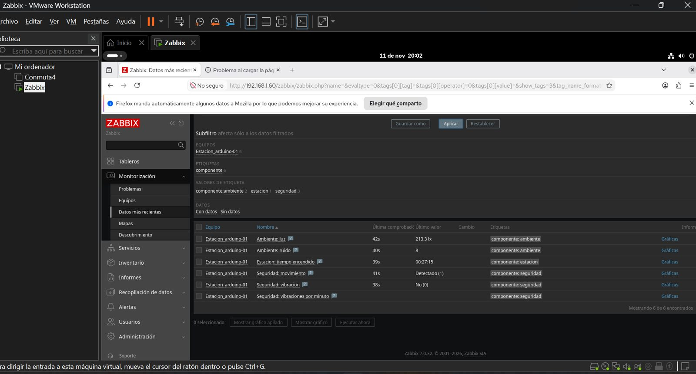
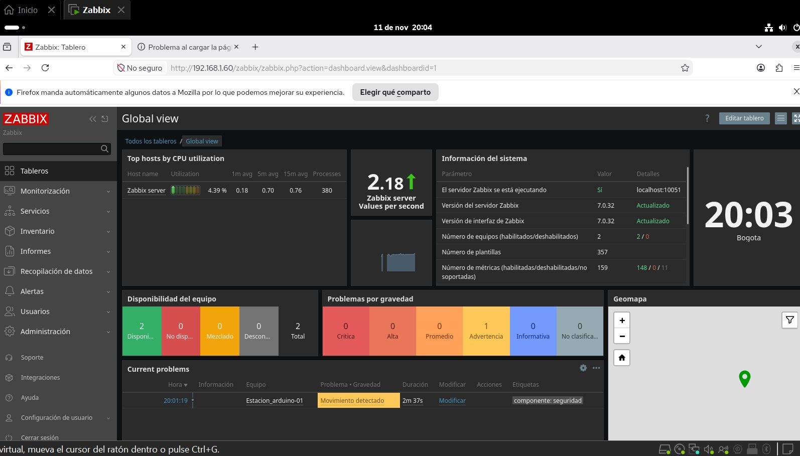
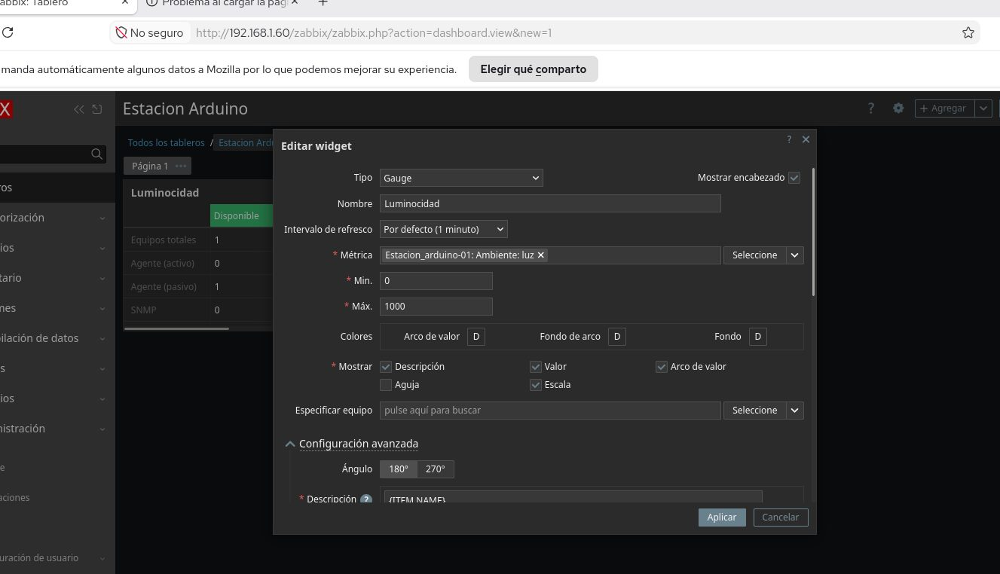
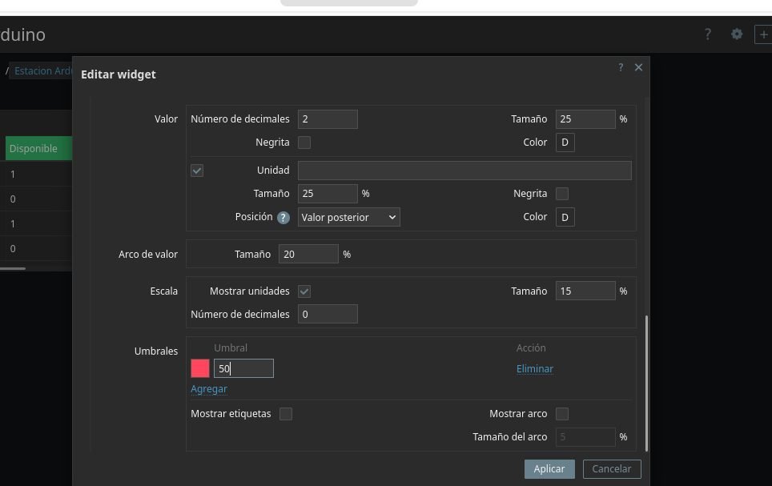
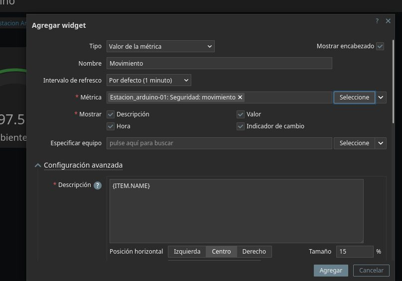
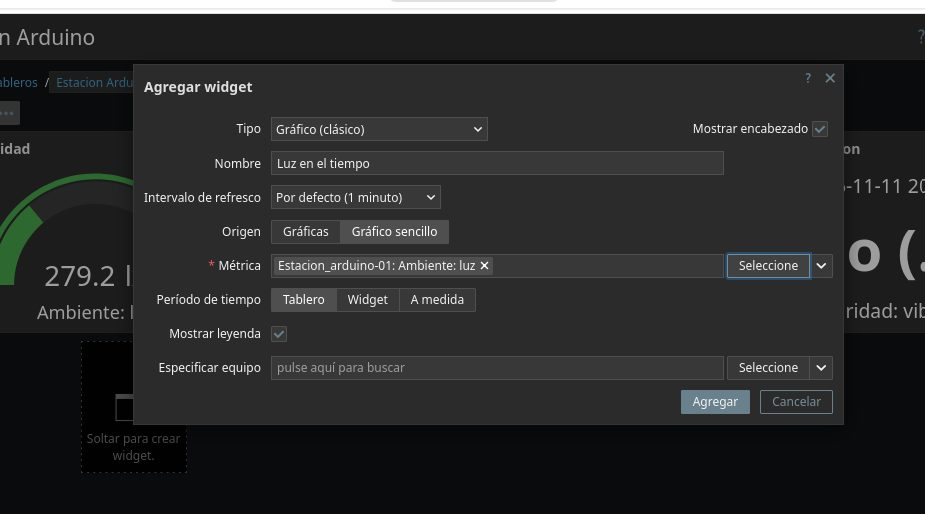
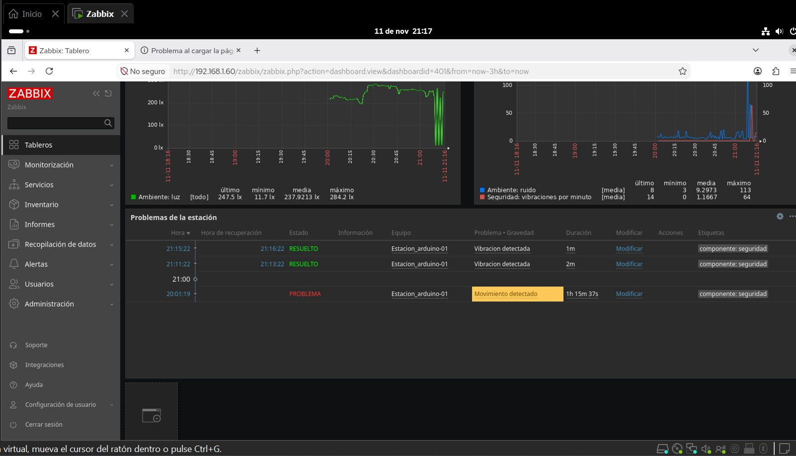
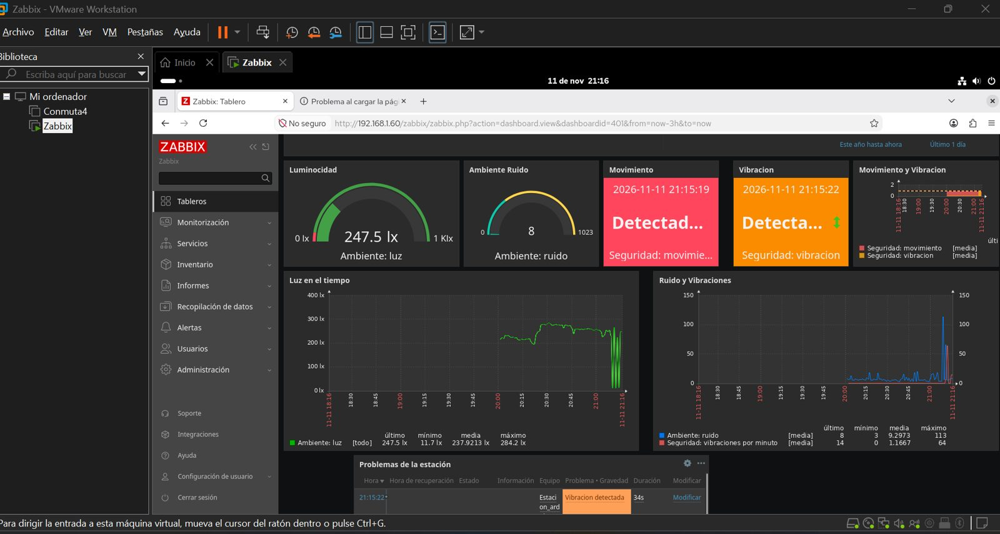

# 6. Plantilla, equipo y tablero en Zabbix

## Paso 6.1 – Importar la plantilla

La plantilla [`zabbix/plantilla_estacion_arduino.yaml`](../zabbix/plantilla_estacion_arduino.yaml) contiene todo lo necesario para monitorear la estación. Se importa en **Recopilación de datos → Plantillas → Importar**.

Contenido de la plantilla **"Estacion Arduino Zabbix"** (grupo `Templates/IoT`):

**Métricas** (agente Zabbix, intervalo de 1 min):

| Nombre | Clave | Tipo | Notas |
|---|---|---|---|
| Ambiente: luz | `sensor.luz` | Flotante (lx) | — |
| Seguridad: movimiento | `sensor.movimiento` | Entero | Mapa de valores "Deteccion" (0 = No, 1 = Detectado) |
| Seguridad: vibracion | `sensor.vibracion` | Entero | Mapa "Deteccion" |
| Seguridad: vibraciones por minuto | `sensor.vibraciones` | Entero | Preprocesamiento *Cambio simple* (de contador a eventos por minuto) |
| Ambiente: ruido | `sensor.ruido` | Entero (0 a 1023) | — |
| Estacion: tiempo encendida | `sensor.uptime` | Entero (s) | — |

**Macros (umbrales ajustables):**

| Macro | Valor final | Uso |
|---|---|---|
| `{$LUZ.BAJA}` | 5 | lx por debajo de los cuales hay "baja luminosidad" |
| `{$LUZ.MARGEN}` | 5 | Histéresis para recuperar |
| `{$LUZ.CAMBIO}` | 30 | Cambio en lx entre lecturas consideradas "bruscas" |
| `{$RUIDO.ALTO}` | 80 | Pico de ruido que genera alerta |
| `{$RUIDO.MARGEN}` | 20 | Histéresis del ruido |
| `{$SIN.DATOS}` | 3m | Tiempo sin datos antes de alertar |

**Iniciadores:**

| Iniciador | Expresión | Severidad |
|---|---|---|
| Estacion sin datos por `{$SIN.DATOS}` | `nodata(/…/sensor.uptime,{$SIN.DATOS})=1` | Alta |
| Estacion reiniciada | `last(/…/sensor.uptime)<300` | Información |
| Baja luminosidad | `max(/…/sensor.luz,#3)<{$LUZ.BAJA}` (recupera con `min(#3) >= BAJA+MARGEN`) | Advertencia |
| Cambio brusco de luz | `abs(change(/…/sensor.luz))>{$LUZ.CAMBIO}` | Advertencia |
| Movimiento detectado | `last(/…/sensor.movimiento)=1` | Advertencia |
| Vibracion detectada | `last(/…/sensor.vibracion)=1` | Media |
| Ruido alto | `last(/…/sensor.ruido)>{$RUIDO.ALTO}` (recupera con `< ALTO-MARGEN`) | Media |

Todos los iniciadores de sensores **dependen** de "Estacion sin datos". Si la estación se desconecta, se informa un solo problema y no una cascada de alertas.

**Gráficos:** Luz, Ruido y vibraciones, Movimiento y vibración.

## Paso 6.2 – Crear el equipo

En **Recopilación de datos → Equipos → Crear equipo**:

- Nombre: `Estacion_arduino-01`
- Plantilla: `Estacion Arduino Zabbix`
- Grupo: `Estacion Arduino` (nuevo; la acción de Telegram lo usa como condición)
- Interfaz: **Agente**, IP `127.0.0.1`, puerto `10050` (modo USB). En modo Ethernet sería la IP del Arduino, `192.168.1.50`.

## Paso 6.3 – Verificar los datos

En **Monitorización → Datos recientes**, filtrando por el equipo, deben aparecer las seis métricas con valores actualizados cada minuto.

El primer problema real que apareció fue **Movimiento detectado**, al pasar frente al PIR:

## Paso 6.4 – Construir el tablero

En **Tableros → Crear tablero** ("Estación Arduino") se agregaron estos widgets:

| Widget | Tipo | Configuración |
|---|---|---|
| Luminosidad | **Indicador** (Gauge) | Métrica `Ambiente: luz`, mín. 0, máx. 1000 lx, umbrales de color |
| Ambiente Ruido | **Indicador** | Métrica `Ambiente: ruido`, mín. 0, máx. 1023 |
| Movimiento | **Valor de métrica** (Item value) | `Seguridad: movimiento`, con mapa de valores y color de fondo por umbral |
| Vibración | **Valor de métrica** | `Seguridad: vibracion` |
| Luz en el tiempo | **Gráfico** | `Ambiente: luz` |
| Ruido y Vibraciones | **Gráfico** | `Ambiente: ruido` + `vibraciones por minuto` (eje derecho) |
| Movimiento y Vibración | **Gráfico** | Las dos métricas binarias |
| Problemas de la estación | **Problemas** | Filtro por el equipo `Estacion_arduino-01` |

> El widget "Item value" aparece en español como **"Valor de métrica"**.

Los cambios del tablero se ven **solo después de pulsar "Guardar cambios"**. Mientras está en modo edición, los widgets no se refrescan.

**Resultado:** tablero completo con datos en vivo, que reacciona en menos de un minuto al movimiento, la vibración y el ruido.

