# 7. Alertas por Telegram

El docente dio a elegir entre alertas por **correo Gmail** o por **Telegram**. Se eligió **Telegram**, que entrega los avisos al celular en segundos.

Flujo: `Iniciador → Problema → Acción "Alertas estación Arduino a Telegram" → Tipo de medio Telegram (webhook) → API de Telegram → chat del usuario`.

## Paso 7.1 – Crear el bot con @BotFather

1. En Telegram, abrir **@BotFather** y enviar `/newbot`.
2. Nombre visible: `ZabbixUMNG`.
3. Usuario (debe terminar en `bot`): `zabbix_estacion_umng_bot`. El primer intento, sin el sufijo, fue rechazado.
4. BotFather entrega el **token HTTP API**. Es secreto: con él cualquiera puede controlar el bot.

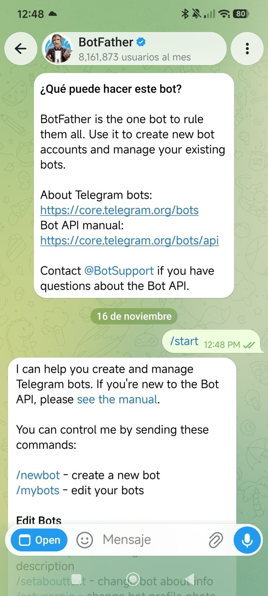
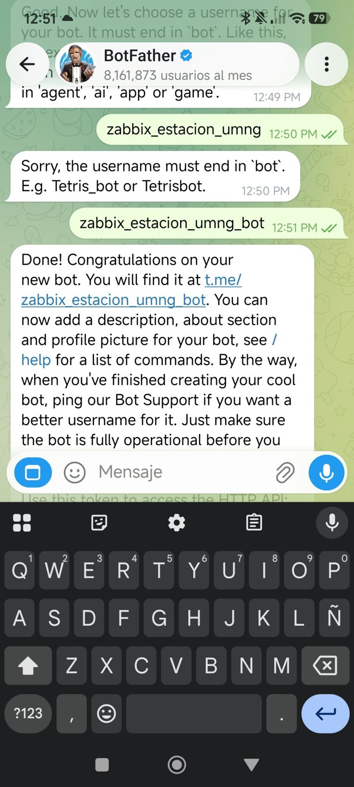

5. Abrir el chat con el bot y pulsar **Iniciar** (`/start`). Un bot no puede escribirle a quien no lo ha iniciado.

## Paso 7.2 – Obtener el chat ID

Se usó el bot **IDBot** con el comando `/getid` para obtener el identificador numérico del usuario destinatario: `7118759491`.

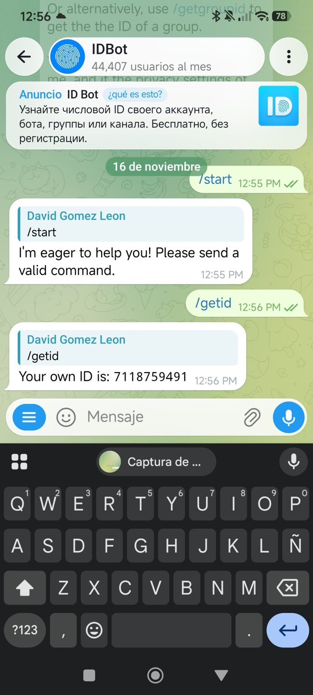

## Paso 7.3 – Configurar el tipo de medio

En **Alertas → Tipos de medios → Telegram** (ya viene en Zabbix 7.0):

| Parámetro | Valor |
|---|---|
| `api_token` | Token de BotFather (no se muestra) |
| `api_parse_mode` | `html` |
| `tls_verify` | `{$HTTP.TLS.VERIFY:"Telegram"}` (true) |
| Activado | ✔ |

Al terminar se pulsa **Modificar** para guardar.

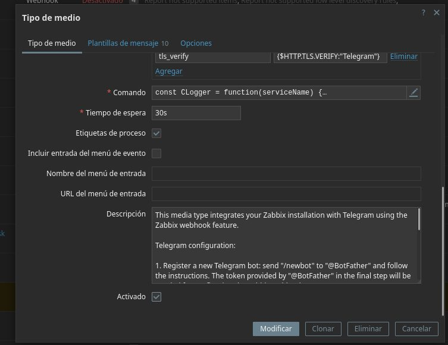

## Paso 7.4 – Probar el tipo de medio

Con el botón **Probar**, la primera prueba falló con `Value "event_tags" contains invalid JSON`. El formulario de prueba trae las macros sin resolver (`{EVENT.TAGSJSON}`), así que hay que llenar los campos a mano:

| Campo | Valor de prueba |
|---|---|
| `alert_message` / `alert_subject` | Texto cualquiera |
| `api_chat_id` | `7118759491` |
| `event_source` | `0` |
| `event_tags` | `[]` |
| `event_update_status` | `0` |
| `event_value` | `1` |
| `event_nseverity` / `event_update_nseverity` | `2` |
| `tls_verify` | `true` |

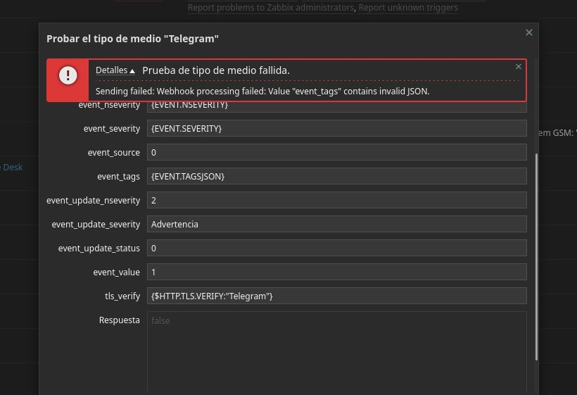
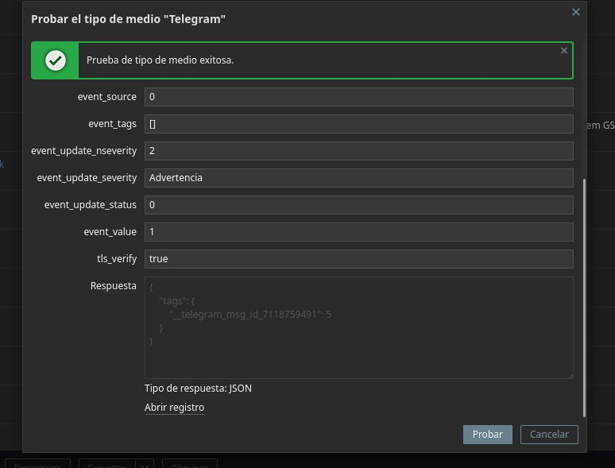
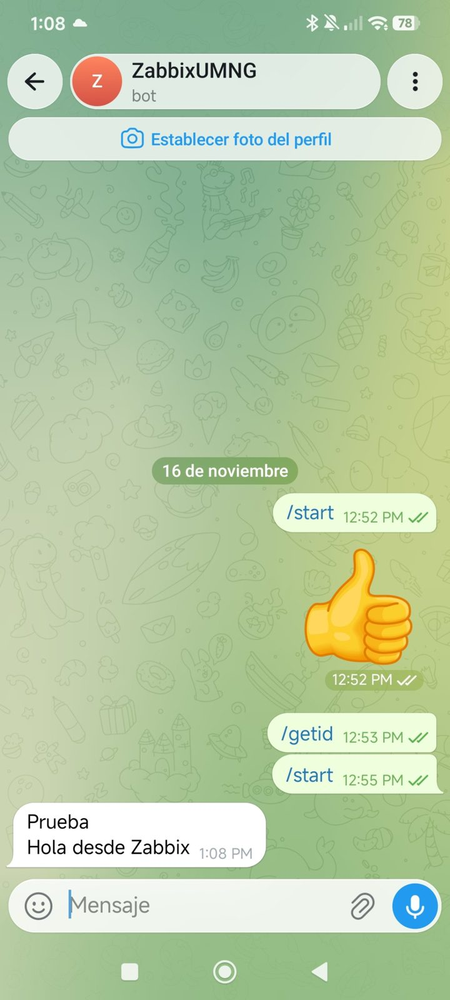

## Paso 7.5 – Medio del usuario Admin

En **Usuarios → Usuarios → Admin → Medio → Agregar**:

- Tipo: `Telegram`
- Enviar a: `7118759491`
- Cuándo está activo: `1-7,00:00-24:00`
- Gravedades: todas

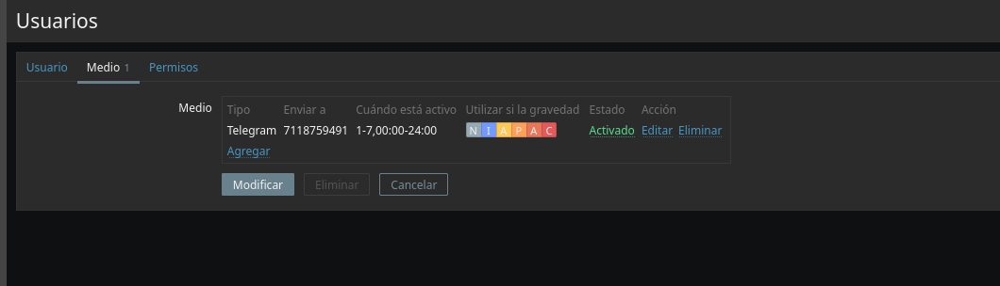

## Paso 7.6 – Crear la acción

En **Alertas → Acciones → Acciones de iniciador → Crear acción**:

- **Nombre:** `Alertas estación Arduino a Telegram`
- **Condición:** *Grupo del equipo igual a "Estacion Arduino"*

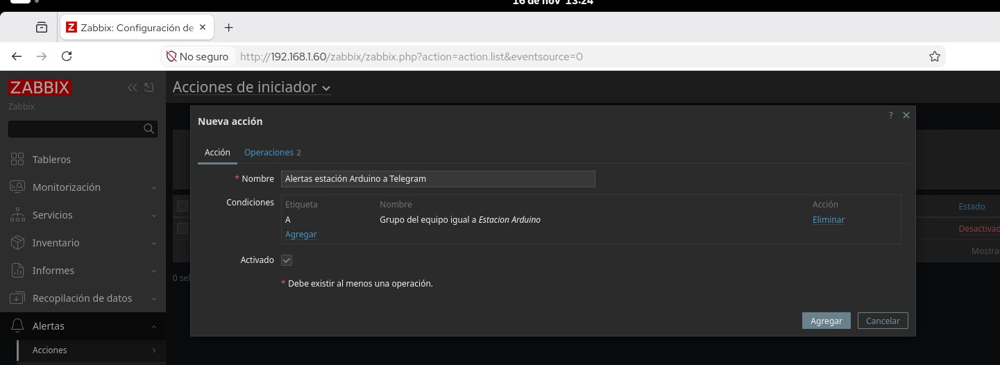

- **Operaciones:** *Enviar mensaje a usuarios: Admin a través de Telegram*, de inmediato.
- **Operaciones de recuperación:** *Notificar a todos los involucrados*, para recibir también el aviso de "resuelto".

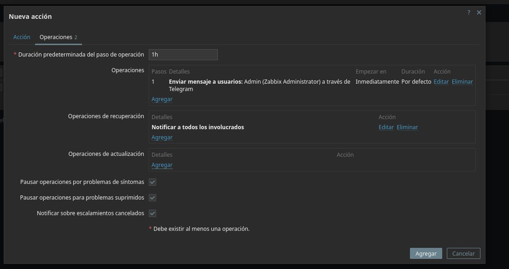
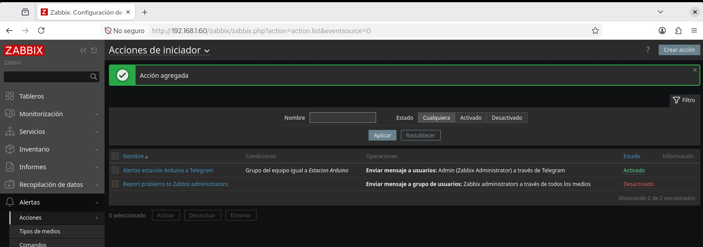

> **Importante:** las acciones solo actúan sobre problemas **nuevos**. Un problema que ya estaba activo antes de crear la acción (como el "Movimiento detectado" del 11 de noviembre) nunca genera mensaje.

## Paso 7.7 – Ajuste de iniciadores para alertar de verdad

Con la acción lista solo llegaban avisos de **vibración**. Se revisaron los demás iniciadores y se hicieron estos cambios:

1. **Ruido alto:** la expresión original `min(sensor.ruido,#3)>{$RUIDO.ALTO}` exigía tres lecturas seguidas por encima del umbral. El ruido es impulsivo (aplausos, golpes), así que nunca se cumplía. Se cambió a `last(...)>{$RUIDO.ALTO}`, con recuperación `last(...)<{$RUIDO.ALTO}-{$RUIDO.MARGEN}`. También se agregaron **Datos operativos** `Nivel: {ITEM.LASTVALUE1}` para ver el valor en el mensaje.

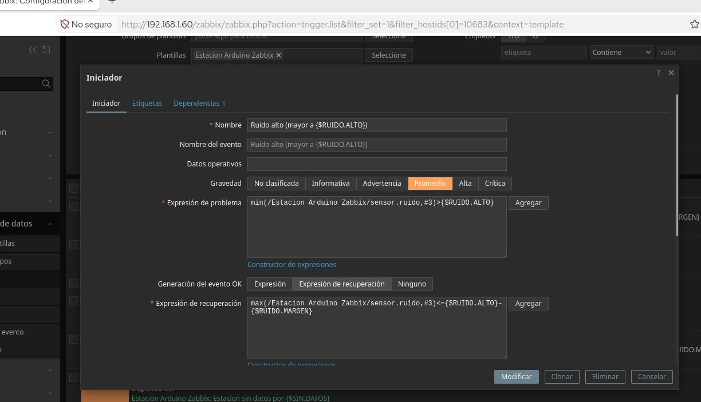

2. **Cambio brusco de luz (nuevo):** `abs(change(/Estacion Arduino Zabbix/sensor.luz))>{$LUZ.CAMBIO}`, con la nueva macro `{$LUZ.CAMBIO}=30`. Avisa si se apaga o enciende la luz o si alguien tapa el sensor.

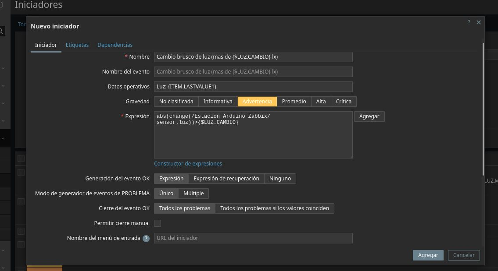

3. **Dependencias:** al crear el iniciador nuevo se seleccionó por error la dependencia "Ruido alto". Se corrigió a **"Estacion sin datos por `{$SIN.DATOS}`"**, como el resto.

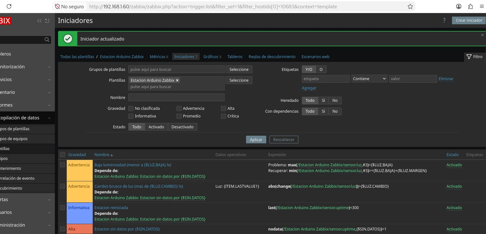

4. **Calibración de macros** con los datos reales del laboratorio, donde la iluminación medida va de unos 5 a 20 lx:

| Macro | Inicial | Final | Motivo |
|---|---|---|---|
| `{$LUZ.BAJA}` | 50 | **5** | Con 50 lx la alarma de baja luz estaba activa todo el tiempo |
| `{$LUZ.MARGEN}` | 20 | **5** | Proporcional al nuevo umbral |
| `{$LUZ.CAMBIO}` | — | **30** | Macro nueva |
| `{$RUIDO.ALTO}` | 80 | 80 | El fondo del salón está entre 8 y 40, y las voces o aplausos superan 80 |

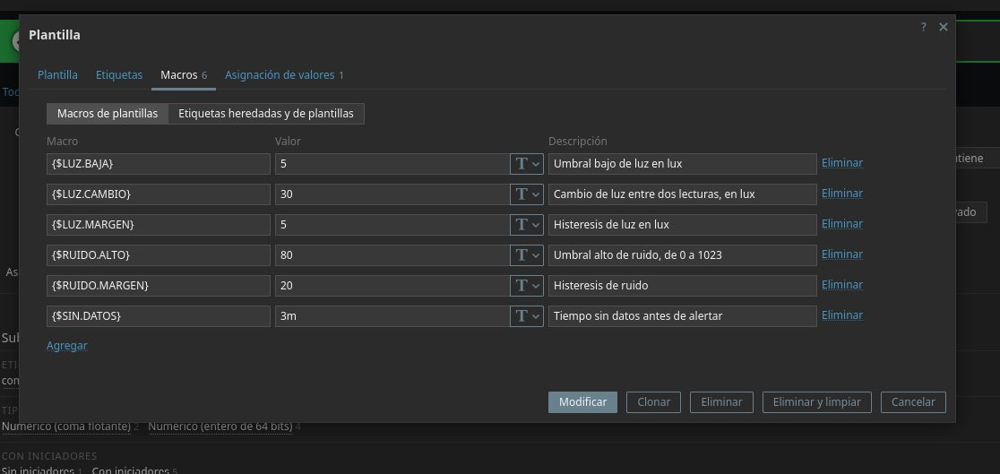

Estos cambios también se aplicaron al archivo `plantilla_estacion_arduino.yaml` del repositorio, de modo que una nueva importación ya queda calibrada.

## Paso 7.8 – Resultado

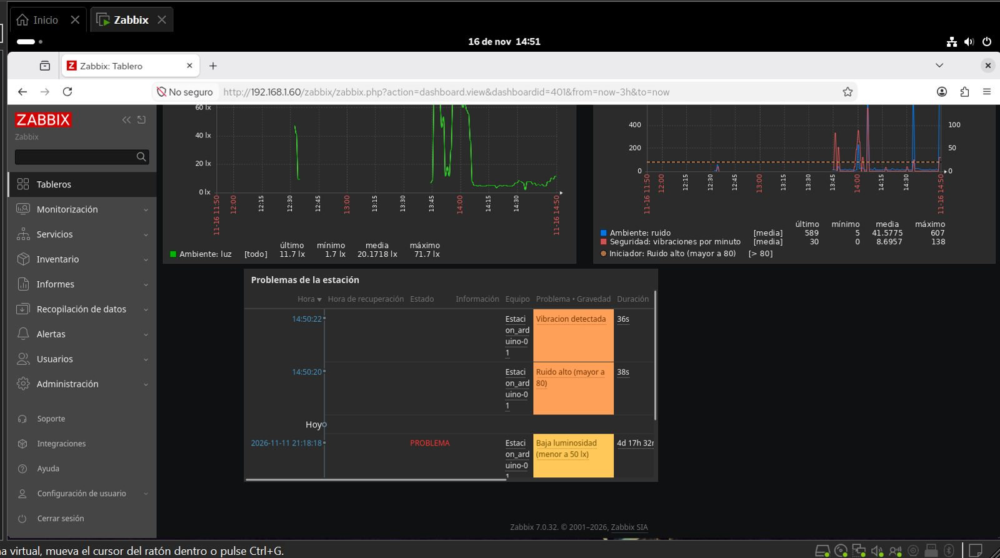

Llegan alertas de **problema** y **resolución** para vibración, ruido alto y baja luminosidad, con el valor medido:

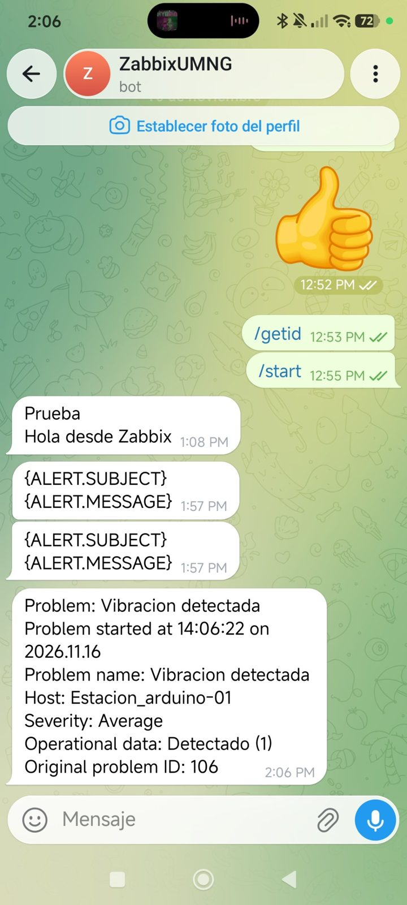
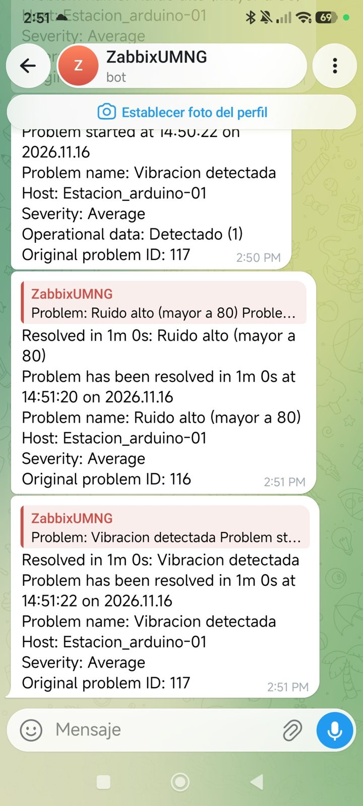
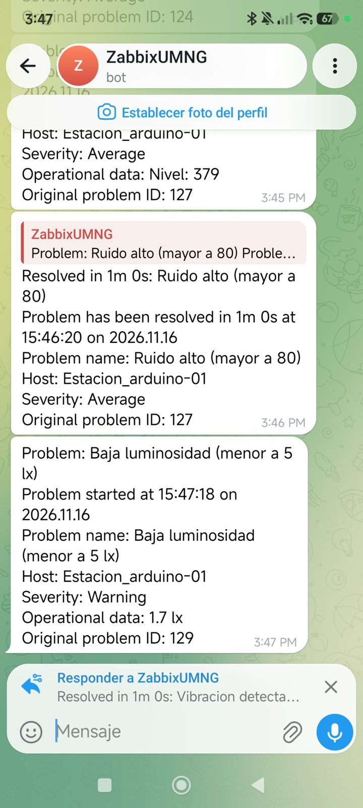

> **Seguridad:** el token del bot, las contraseñas de la base de datos y la del usuario Admin **no deben subirse** a GitHub ni aparecer en capturas. Las capturas de este repositorio se seleccionaron para que no muestren el token.
