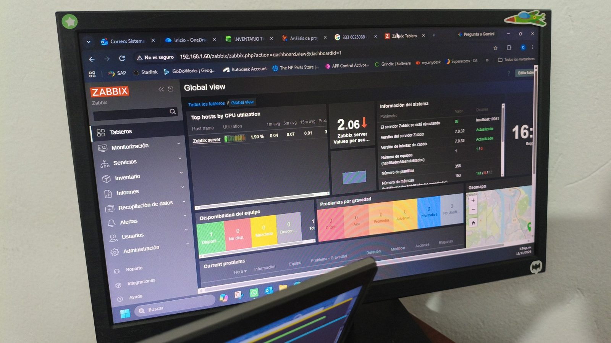
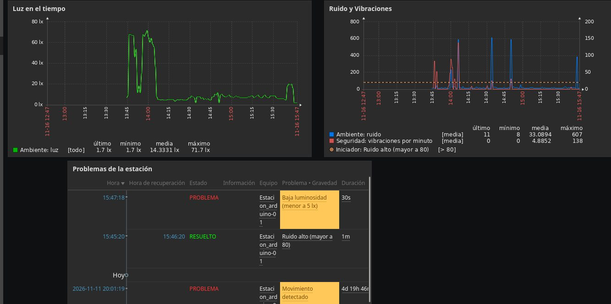

# 8. Resultados y análisis de datos

## 8.1 Funcionamiento logrado

| Requisito | Estado | Evidencia |
|---|---|---|
| Servidor Zabbix 7.0 en CentOS operativo | ✔ | Sección 2 |
| Arduino con 4 sensores y LEDs indicadores | ✔ | Sección 3 |
| Firmware con agente Zabbix (USB y Ethernet) | ✔ | Sección 4 |
| Recolección de datos cada minuto | ✔ | Datos recientes, gráficos |
| Plantilla con métricas, iniciadores, macros y gráficos | ✔ | Sección 6 |
| Tablero en tiempo real | ✔ | Sección 6.4 |
| Alertas de problema y resolución en Telegram | ✔ | Sección 7.8 |
| Dependencias para evitar alertas en cascada | ✔ | Sección 7.7 |

## 8.2 Datos observados

### Sesión del 11 de noviembre (18:16 a 21:16, primera puesta en marcha)

| Variable | Mínimo | Promedio | Máximo |
|---|---|---|---|
| Luz (lx) | 11,7 | 237,9 | 284,2 |
| Ruido (0 a 1023) | 3 | 9,3 | 113 |
| Vibraciones por minuto | 0 | 1,2 | 64 |

Durante esta sesión el sensor estaba cerca de una fuente de luz artificial, con valores de unos 250 lx. Las caídas bruscas al final corresponden a pruebas tapando el sensor.

### Sesión del 16 de noviembre (12:47 a 15:47, laboratorio)

| Variable | Mínimo | Promedio | Máximo | Último |
|---|---|---|---|---|
| Luz (lx) | 1,7 | 14,3 | 71,7 | 1,7 |
| Ruido (0 a 1023) | 8 | 33,1 | 607 | 11 |
| Vibraciones por minuto | 0 | 4,9 | 138 | 0 |

**Interpretación:**

- **Luz:** entre 13:45 y 14:05 se midieron 60 a 72 lx, cuando hubo luz directa o natural sobre el sensor. El resto del tiempo el ambiente se mantuvo entre 5 y 20 lx. El paso de unos 70 a unos 5 lx hacia las 14:05 es el tipo de evento que detecta el iniciador **Cambio brusco de luz**. A las 15:47 el valor bajó a 1,7 lx (sensor tapado) y disparó **Baja luminosidad**, que llegó por Telegram.
- **Ruido:** el fondo del salón está entre 8 y 40 unidades. Los picos de 380 a 607 corresponden a voces cercanas, aplausos y golpes. El umbral de 80 (línea punteada naranja del gráfico) separa bien el fondo de los eventos. Por eso el iniciador se cambió a `last()`: el ruido es **impulsivo** y no se mantiene durante tres lecturas.
- **Vibración:** los picos de 50 a 138 vibraciones por minuto coinciden con los golpes de prueba en la mesa (13:45 a 14:05). Varios picos de vibración coinciden con picos de ruido: un golpe genera las dos señales, lo que confirma que ambos sensores responden al mismo evento físico.

### Correlación de eventos

| Evento físico | Luz | Ruido | Vibración | Movimiento |
|---|---|---|---|---|
| Golpe en la mesa | — | ↑ pico | ↑ pico | — |
| Hablar o aplaudir cerca | — | ↑ pico | — | — |
| Tapar el sensor de luz | ↓ brusco | — | — | posible ↑ |
| Pasar frente a la estación | — | — | — | ↑ (60 s) |

## 8.3 Alertas recibidas

| Hora (16-nov) | Problema | Gravedad | Dato operativo | Resolución |
|---|---|---|---|---|
| 14:06:22 | Vibracion detectada (primera alerta real) | Media | Detectado (1) | Resuelto en ~1 min |
| 15:45:20 | Ruido alto (mayor a 80) | Media | Nivel: 379 | Resuelto 15:46:20 (1 min) |
| 15:47:18 | Baja luminosidad (menor a 5 lx) | Advertencia | 1,7 lx | — |

La duración aproximada de 1 minuto de los problemas de vibración y ruido coincide con la ventana de retención del firmware (60 s) y el intervalo de consulta (1 min).

## 8.4 Observaciones y pendientes

- **PIR con "Movimiento detectado" activo desde el 11-nov 20:01.** El sensor reporta 1 de forma continua. Las causas probables son el potenciómetro de tiempo (Tx) al máximo, el jumper en modo repetitivo con movimiento constante en el campo de visión, o un cable de salida flotante. Acciones recomendadas: girar Tx al mínimo, tapar el sensor con una caja y comprobar que vuelva a 0 en el monitor serie, y revisar la conexión de OUT a D7.
- **Cambio brusco de luz:** el iniciador está configurado y la variación observada (de unos 70 a unos 5 lx) supera el umbral, pero se creó después de ese evento, así que aún no ha generado alerta. Se puede probar encendiendo y apagando la luz del salón.
- **Mensajes:** las plantillas de mensaje del tipo de medio están en inglés (las de fábrica). Se pueden traducir en **Tipo de medio → Plantillas de mensaje**.
- **Análisis de varios días:** para estudiar el patrón día/noche y la ocupación del salón, se recomienda dejar la estación en funcionamiento **al menos 3 días** y usar **Monitorización → Gráficos** con un rango de 72 h, o exportar el historial (**Datos recientes → Historial → Exportar a CSV**).
