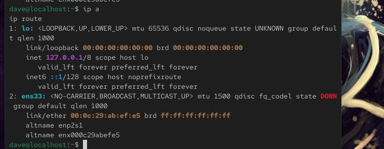
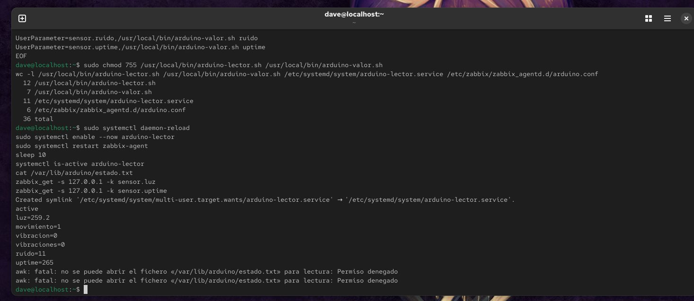
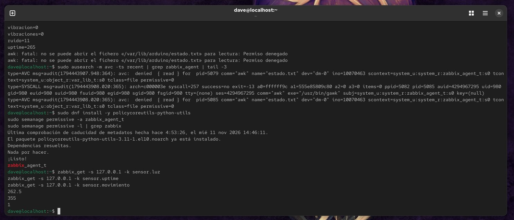
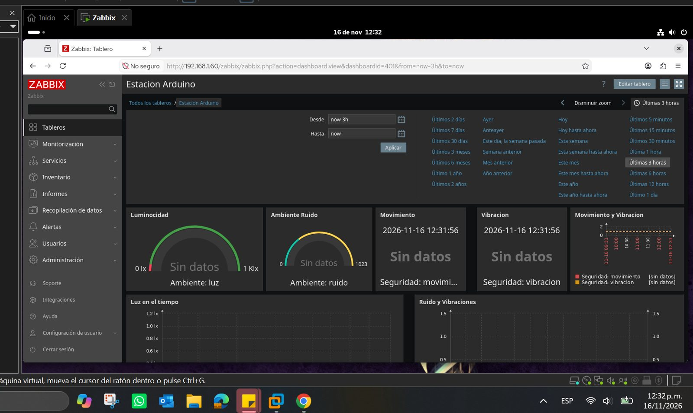
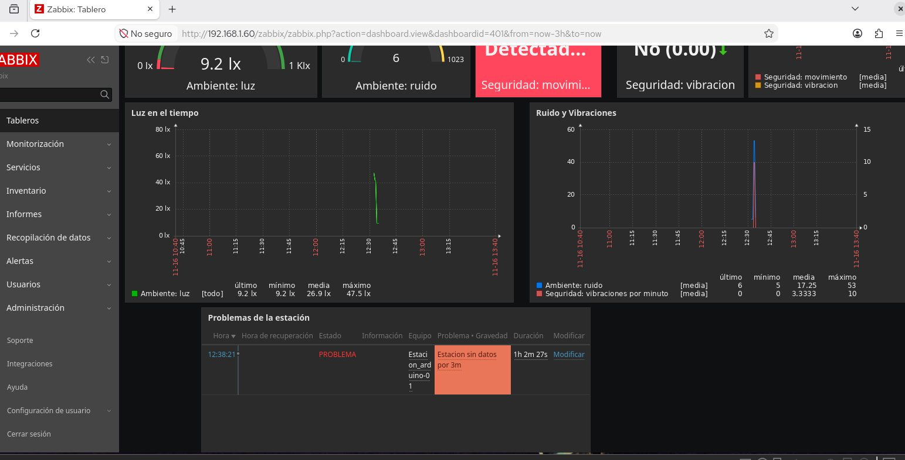
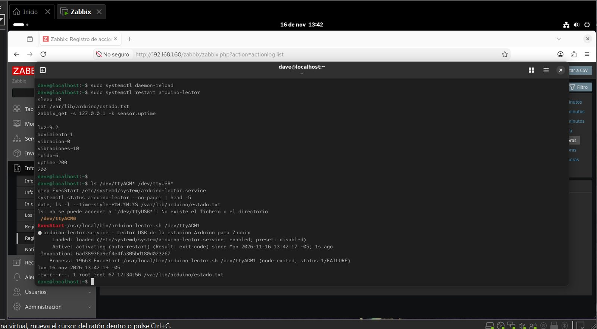
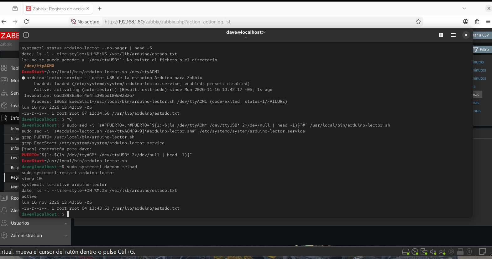
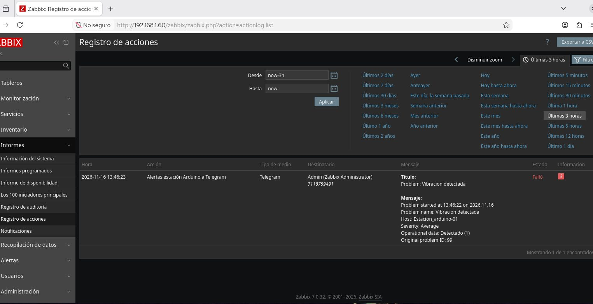
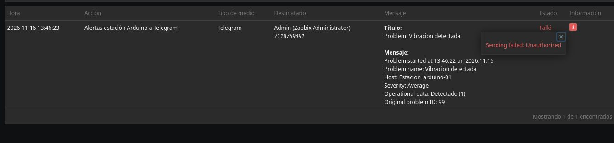

# 9. Bitácora de incidentes

Registro de los problemas encontrados durante el desarrollo, su causa y la solución aplicada, en orden cronológico.

## 9.1 Resumen

| # | Fecha | Fase | Síntoma | Causa raíz | Solución |
|---|---|---|---|---|---|
| 1 | 03-nov | Servidor | `apt: orden no encontrada` | La guía inicial era para Ubuntu; el servidor es CentOS Stream 10 | Rehacer la guía con `dnf`, `firewalld` y SELinux |
| 2 | 11-nov | Red | `ens33` en `NO-CARRIER`, sin IP | Adaptador virtual desconectado en VMware | Marcar **Conectado** y modo puente; `nmcli device connect ens33` |
| 3 | 11-nov | Servidor | 404 al instalar el repositorio de Zabbix | Ruta `centos/10` inexistente | Usar `rhel/10/x86_64/zabbix-release-latest-7.0.el10.noarch.rpm` |
| 4 | 11-nov | Puente USB | Archivos de configuración incompletos | El pegado de heredocs largos en la terminal se truncó | Pegar cada bloque por separado y verificar con `wc -l` (12/7/11/6) |
| 5 | 11-nov | Puente USB | `zabbix_get` → "Permiso denegado" en `awk` | SELinux bloqueaba al dominio `zabbix_agent_t` | `semanage permissive -a zabbix_agent_t` (solo ese dominio) |
| 6 | 11-nov | Tablero | Widgets sin datos o con escalas incorrectas | Tipo de widget o umbrales mal elegidos; "Item value" se llama "Valor de métrica" | Corregir el tipo, el rango mín./máx. y los umbrales del indicador |
| 7 | 11-nov | Tablero | Los cambios no aparecían | El tablero no se refresca en modo edición | Pulsar **Guardar cambios** |
| 8 | 16-nov | Puente USB | Tablero "sin datos" tras reconectar el Arduino | El servicio quedó apuntando a un puerto fijo (`ttyACM1`) que no existía | Detección automática del puerto en `arduino-lector.sh` y `ExecStart` sin argumento |
| 9 | 16-nov | Telegram | Prueba del medio falla: `event_tags contains invalid JSON` | El formulario de prueba trae macros sin resolver | Llenar los campos de prueba con valores reales (`[]`, `0`, `1`, `true`) |
| 10 | 16-nov | Telegram | Registro de acciones: "Falló … Unauthorized" | El token se revocó y se generó uno nuevo, pero no se guardó en el tipo de medio | Pegar el token nuevo en `api_token` y pulsar **Modificar** |
| 11 | 16-nov | Alertas | Solo llegaban alertas de vibración | (a) Dependencia de "sin datos" activa; (b) problemas anteriores a la acción no notifican; (c) `min(#3)` en ruido nunca se cumplía; (d) umbral de luz de 50 lx siempre activo | Esperar a que se resolviera "sin datos", cambiar el ruido a `last()`, calibrar macros y crear "Cambio brusco de luz" |
| 12 | 16-nov | Iniciadores | El nuevo iniciador dependía de "Ruido alto" | Error al seleccionar la dependencia | Cambiarla a "Estacion sin datos por `{$SIN.DATOS}`" |
| 13 | 11 al 16-nov | Hardware | "Movimiento detectado" activo permanentemente | Ajuste del PIR (Tx o jumper) o salida flotante | **Pendiente:** Tx al mínimo, prueba tapado, revisar OUT→D7 |

## 9.2 Detalle de incidentes relevantes

### Incidente 2 – Red de la VM sin portadora



La interfaz `ens33` aparecía como `NO-CARRIER` porque el adaptador virtual no estaba conectado. Después de marcar **Conectado** en la configuración de VMware y elegir la red en puente, se activó con `nmcli device connect ens33`. La VM recibió IP por DHCP y luego se fijó en 192.168.1.60.

### Incidente 5 – SELinux bloquea al agente



El agente Zabbix corre confinado en el dominio SELinux `zabbix_agent_t`, que por defecto no puede ejecutar scripts arbitrarios ni leer `/var/lib/arduino`. `ausearch -m avc` mostró las denegaciones. En lugar de desactivar SELinux en todo el sistema (`setenforce 0`), se dejó en modo permisivo **solo ese dominio**, que es la opción de menor impacto.



### Incidente 8 – Pérdida de datos al reconectar el Arduino (16-nov)



**Contexto:** al retomar el proyecto se desconectó el Arduino del PC. Al reconectarlo, VMware preguntó si conectarlo al host o a la VM, y se eligió la VM. Aun así, el tablero no mostraba datos (el último dato en `estado.txt` era de las 12:34:56).



**Diagnóstico:**

```bash
ls /dev/ttyACM* /dev/ttyUSB*
grep ExecStart /etc/systemd/system/arduino-lector.service
systemctl status arduino-lector --no-pager | head -5
```

El dispositivo era `/dev/ttyACM0`, pero el servicio se había modificado con `sed` para leer `/dev/ttyACM1`, bajo el supuesto de que el puerto había cambiado al reconectar. El servicio quedó en bucle `activating (auto-restart) … status=1/FAILURE`.



**Solución definitiva:** que el script detecte el puerto solo y que el servicio no reciba argumento:

```bash
# arduino-lector.sh
PUERTO="${1:-$(ls /dev/ttyACM* /dev/ttyUSB* 2>/dev/null | head -1)}"
# arduino-lector.service
ExecStart=/usr/local/bin/arduino-lector.sh
```

```bash
sudo systemctl daemon-reload
sudo systemctl restart arduino-lector
```



Luego, en Zabbix, se usó **Ejecutar ahora** sobre las métricas para no esperar al siguiente ciclo. Los datos volvieron en 1 a 3 minutos y el problema "Estacion sin datos" se resolvió solo.

**Lección aprendida:** los nombres `ttyACM*` no son estables entre reconexiones. Una opción aún más robusta es crear una regla `udev` que cree un enlace fijo (por ejemplo `/dev/arduino`) según el número de serie de la placa.

### Incidente 10 – "Unauthorized" en Telegram




La prueba del tipo de medio había salido bien, pero los envíos reales fallaban con `Unauthorized`. El token original quedó expuesto en una captura y se **revocó** en BotFather; el token nuevo no se había guardado en el tipo de medio. Al pegarlo en `api_token` y pulsar **Modificar**, los envíos funcionaron.

**Lección aprendida:** un token expuesto se revoca de inmediato, y después se actualiza en todos los lugares donde se usa.

### Incidente 11 – Solo llegaban alertas de vibración

Hubo cuatro causas combinadas:

1. Mientras "Estacion sin datos" estuvo activo (incidente 8), las **dependencias** suprimieron los demás iniciadores. Es el comportamiento esperado.
2. "Movimiento detectado" ya estaba activo desde el 11-nov, antes de crear la acción. Zabbix **no notifica problemas que ya existían**.
3. "Ruido alto" usaba `min(#3)`, que exige tres lecturas seguidas sobre el umbral; el ruido es impulsivo.
4. `{$LUZ.BAJA}=50` dejaba el problema de baja luz activo todo el tiempo en un salón de 5 a 20 lx, así que nunca había un problema *nuevo*.

Después de los ajustes de la sección 7.7 llegaron alertas de ruido y de baja luminosidad con su resolución.
