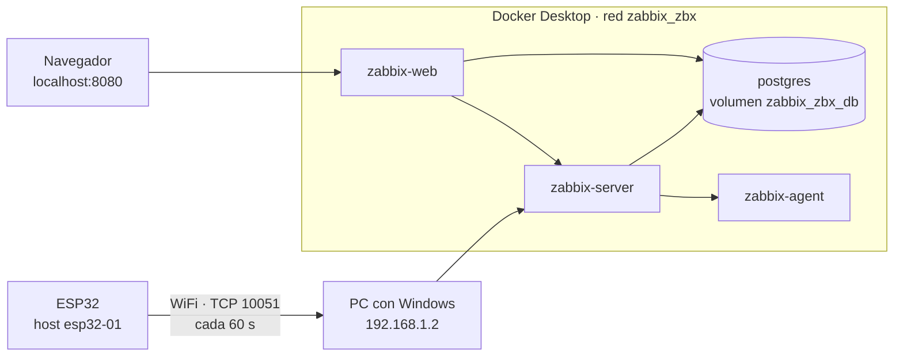

# Monitoreo de un ESP32 con Zabbix en Docker
 
**Proyecto final · Gestión de Red**
 
Este proyecto levanta un servidor **Zabbix 7.0 LTS** en Docker Desktop (Windows) y lo conecta con una placa **ESP32**. Cada 60 segundos, el ESP32 envía por WiFi tres métricas: la intensidad de la señal WiFi, el tiempo que lleva encendido y la memoria libre. Zabbix las guarda, las grafica y puede generar alertas.
 
## Contenido
 
- [Arquitectura](#arquitectura)
- [Requisitos](#requisitos)
- [Parte 1: Levantar Zabbix con Docker](#parte-1-levantar-zabbix-con-docker)
- [Parte 2: Comunicación entre el ESP32 y Zabbix](#parte-2-comunicación-entre-el-esp32-y-zabbix)
- [Resultado](#resultado)
- [Solución de problemas](#solución-de-problemas)
- [Archivos del proyecto](#archivos-del-proyecto)
## Arquitectura
 

 
| Componente | Imagen de Docker | Función |
| --- | --- | --- |
| `postgres` | `postgres:16-alpine` | Base de datos: guarda la configuración y el historial |
| `zabbix-server` | `zabbix/zabbix-server-pgsql:alpine-7.0-latest` | Recibe los datos, los evalúa y genera los problemas. Publica el puerto **10051** |
| `zabbix-web` | `zabbix/zabbix-web-nginx-pgsql:alpine-7.0-latest` | Interfaz web. Publica el puerto **8080** |
| `zabbix-agent` | `zabbix/zabbix-agent2:alpine-7.0-latest` | Agente que monitorea el propio servidor |
| ESP32 | Programa `esp32_zabbix.ino` | Envía sus métricas a Zabbix con el método *Zabbix trapper* |
 
## Requisitos
 
- Windows 10 u 11 con **Docker Desktop** instalado y en funcionamiento (*Engine running*).
- Placa **ESP32** (por ejemplo, ESP32 DevKit V1) y un cable USB **de datos**.
- Red WiFi de **2.4 GHz**. El ESP32 y el PC deben estar conectados al mismo router.
- **Arduino IDE 2** con el paquete de placas *esp32 by Espressif Systems*.
---
 
## Parte 1: Levantar Zabbix con Docker
 
### 1.1 Crear la carpeta del proyecto y ubicarse en ella
 
Se creó una carpeta exclusiva para el contenedor. Docker Compose busca el archivo `docker-compose.yml` en la carpeta actual y usa su nombre (`zabbix`) para nombrar la red y el volumen.
 
```powershell
cd "C:\Users\camil\OneDrive\Escritorio\V SEMESTRE\GESTION DE RED\proyecto final\zabbix"
```
 
> Como la ruta tiene espacios, debe escribirse entre comillas.
 

 
### 1.2 Crear el archivo `docker-compose.yml`
 
Este archivo describe los cuatro contenedores, la red que los une y el volumen donde se guardan los datos.
 
```powershell
notepad docker-compose.yml
```
 

 
> **Nota:** en la captura, el archivo se creó por error fuera de la carpeta `zabbix`; luego se movió a ella. Debe quedar dentro de `zabbix` para que los comandos siguientes lo encuentren.
 
Contenido del archivo:
 
```yaml
# Zabbix 7.0 LTS en Docker Desktop
# Web: http://localhost:8080  (usuario: Admin / clave: zabbix)
 
services:
  postgres:
    image: postgres:16-alpine
    container_name: zabbix-postgres
    restart: unless-stopped
    environment:
      POSTGRES_USER: zabbix
      POSTGRES_PASSWORD: zabbix_pwd
      POSTGRES_DB: zabbix
    volumes:
      - zbx_db:/var/lib/postgresql/data
    networks: [zbx]
 
  zabbix-server:
    image: zabbix/zabbix-server-pgsql:alpine-7.0-latest
    container_name: zabbix-server
    restart: unless-stopped
    depends_on: [postgres]
    environment:
      DB_SERVER_HOST: postgres
      POSTGRES_USER: zabbix
      POSTGRES_PASSWORD: zabbix_pwd
      POSTGRES_DB: zabbix
    ports:
      - "10051:10051"
    networks: [zbx]
 
  zabbix-web:
    image: zabbix/zabbix-web-nginx-pgsql:alpine-7.0-latest
    container_name: zabbix-web
    restart: unless-stopped
    depends_on: [zabbix-server]
    environment:
      ZBX_SERVER_HOST: zabbix-server
      DB_SERVER_HOST: postgres
      POSTGRES_USER: zabbix
      POSTGRES_PASSWORD: zabbix_pwd
      POSTGRES_DB: zabbix
      PHP_TZ: America/Bogota
    ports:
      - "8080:8080"
    networks: [zbx]
 
  zabbix-agent:
    image: zabbix/zabbix-agent2:alpine-7.0-latest
    container_name: zabbix-agent
    restart: unless-stopped
    depends_on: [zabbix-server]
    environment:
      ZBX_HOSTNAME: "Zabbix server"
      ZBX_SERVER_HOST: zabbix-server
    networks: [zbx]
 
networks:
  zbx:
 
volumes:
  zbx_db:
```
 
La contraseña de la base de datos es **`zabbix_pwd`**. Aparece en los servicios `postgres`, `zabbix-server` y `zabbix-web`, y debe ser idéntica en los tres. Si se cambia, hay que hacerlo antes del primer arranque.
 
### 1.3 Arrancar los contenedores
 
```powershell
docker compose up -d
```
 
`up` crea y enciende todo lo que describe el archivo, y `-d` lo deja en segundo plano. La primera vez se descargan las cuatro imágenes; después se crean la red `zabbix_zbx`, el volumen `zabbix_zbx_db` y los cuatro contenedores.
 

 
### 1.4 Comprobar el estado
 
```powershell
docker compose ps
```
 
Los cuatro contenedores deben aparecer en estado `Up` y `zabbix-web` debe indicar `(healthy)`. También se ven los puertos publicados: `8080` para la web y `10051` para recibir datos.
 

 
### 1.5 Revisar los registros del servidor
 
```powershell
docker compose logs -f zabbix-server
```
 
En el primer arranque, el servidor crea las tablas de la base de datos, lo que puede tardar uno o dos minutos. Con `Ctrl + C` se deja de ver el registro; los contenedores siguen funcionando.
 
### 1.6 Ingresar a la interfaz web
 
Abrir **<http://localhost:8080>** e iniciar sesión con:
 
| Campo | Valor |
| --- | --- |
| Username | `Admin` (con *A* mayúscula; distingue mayúsculas) |
| Password | `zabbix` |
 
> Se recomienda cambiar esta contraseña en **User settings → Profile → Change password**, porque es la que trae Zabbix por defecto.
 
---
 
## Parte 2: Comunicación entre el ESP32 y Zabbix
 
### Cómo funciona
 
No se usa un agente Zabbix en el ESP32. Con un agente, el servidor tendría que preguntarle al dispositivo por sus datos; aquí ocurre al revés: **el ESP32 envía sus datos al servidor** cada 60 segundos. Este método se llama **Zabbix trapper**.
 
Se eligió así porque:
 
- No existe un agente Zabbix oficial para ESP32.
- El servidor no necesita conocer la IP del ESP32, aunque esta cambie.
- El puerto `10051`, por donde Zabbix recibe estos datos, ya está publicado en el `docker-compose.yml`.
Cada envío es un mensaje JSON con la cabecera `ZBXD` del protocolo de Zabbix. Por ejemplo:
 
```json
{"request":"sender data","data":[{"host":"esp32-01","key":"esp32.rssi","value":"-55"}]}
```
 
Zabbix solo acepta el dato si existe un host con ese nombre exacto (`esp32-01`) y, dentro de él, un ítem *Zabbix trapper* con esa clave exacta (`esp32.rssi`). Por eso primero se configura Zabbix y después se programa el ESP32.
 
### 2.1 Obtener la IP del PC
 
```powershell
ipconfig
```
 
Se toma la **Dirección IPv4** del adaptador que conecta el PC al router. En este caso es **`192.168.1.2`**, en el adaptador Ethernet. Los adaptadores `vEthernet (WSL)` o `vEthernet (Default Switch)` son redes virtuales internas y no sirven.
 

 
### 2.2 Abrir el puerto 10051 en el firewall
 
El firewall de Windows bloquea por defecto las conexiones que llegan desde otros equipos. Esta regla permite las que van al puerto **10051**. Se ejecuta en PowerShell **como administrador**:
 
```powershell
New-NetFirewallRule -DisplayName "Zabbix trapper 10051" -Direction Inbound -Protocol TCP -LocalPort 10051 -Action Allow
```
 

 
> La red del PC debe estar marcada como **Privada** (Configuración → Red e Internet), porque en una red pública Windows aplica restricciones adicionales.
 
### 2.3 Crear el host en Zabbix
 
En el menú de la izquierda, ir a **Data collection → Hosts** y pulsar **Create host**.
 

 
Se llenan los siguientes campos:
 
| Campo | Valor | Motivo |
| --- | --- | --- |
| Host name | `esp32-01` | Debe coincidir letra por letra con el que envía el ESP32 |
| Host groups | `ESP32` (grupo nuevo) | Zabbix exige que cada host pertenezca a un grupo |
| Templates | *(vacío)* | No existe una plantilla para este dispositivo |
| Interfaces | *(ninguna)* | Con trapper, Zabbix nunca se conecta al ESP32; es el ESP32 quien envía |
 

 
### 2.4 Crear los ítems
 
Los ítems son las métricas que Zabbix espera recibir. En la lista de hosts, se hace clic en **Items**, en la fila de `esp32-01`, y luego en **Create item** (arriba a la derecha).
 

 
Se crearon tres ítems, todos de tipo **Zabbix trapper**:
 
| Name | Key | Type of information | Units | Qué mide |
| --- | --- | --- | --- | --- |
| Señal-wifi | `esp32.rssi` | Numeric (float) | `dBm` | Intensidad de la señal WiFi (valores negativos; más cerca de 0 es mejor) |
| Tiempo encendido | `esp32.uptime` | Numeric (unsigned) | `uptime` | Segundos desde que arrancó el ESP32 |
| Memoria libre | `esp32.heap` | Numeric (unsigned) | `B` | Memoria RAM libre, en bytes |
 
- **Type of information:** la señal WiFi usa *float* porque es negativa; los otros dos son enteros positivos.
- **Units:** solo cambian la forma de mostrar el valor. `uptime` convierte los segundos a formato `hh:mm:ss` y `B` muestra KB o MB automáticamente.
- **Allowed hosts:** se deja vacío. Con Docker Desktop, el servidor puede ver la conexión como si viniera de una dirección interna de Docker, y un filtro por IP bloquearía los datos.
**Señal WiFi**
 

 
**Tiempo encendido**
 

 
**Memoria libre**
 

 
> Después de crear los ítems conviene esperar alrededor de un minuto: el servidor refresca su configuración cada cierto tiempo y, mientras tanto, descarta los datos de ítems que todavía no conoce.
 
### 2.5 Probar el servidor desde el PC
 
Antes de programar el ESP32, se comprueba con un script de Python que el servidor acepta los datos en el mismo formato que usará la placa. Si después algo falla, se sabrá que el problema está en el ESP32 o en la red, y no en el servidor.
 
Se crea el archivo dentro de la carpeta `zabbix`:
 
```powershell
notepad prueba_zabbix.py
```
 

 
Contenido del script:
 
```python
# prueba_zabbix.py: envía un dato de prueba a Zabbix, igual que lo hará el ESP32
import json, socket, struct, sys
 
servidor = sys.argv[1]          # la IP del PC, por ejemplo 192.168.1.2
 
mensaje = {
    "request": "sender data",
    "data": [{"host": "esp32-01", "key": "esp32.rssi", "value": "-50"}],
}
cuerpo = json.dumps(mensaje).encode("utf-8")
cabecera = b"ZBXD\x01" + struct.pack("<II", len(cuerpo), 0)
 
with socket.create_connection((servidor, 10051), timeout=5) as s:
    s.sendall(cabecera + cuerpo)
    respuesta = b""
    while True:
        trozo = s.recv(1024)
        if not trozo:
            break
        respuesta += trozo
 
print("Respuesta de Zabbix:", respuesta[13:].decode("utf-8"))
```
 
Se ejecuta en un contenedor temporal de Python, así no hace falta instalar Python en Windows:
 
```powershell
docker run --rm -v "${PWD}:/app" python:3-alpine python /app/prueba_zabbix.py 192.168.1.2
```
 
La respuesta esperada es:
 
```text
Respuesta de Zabbix: {"response":"success","info":"processed: 1; failed: 0; total: 1; ..."}
```
 
`processed: 1; failed: 0` indica que Zabbix aceptó el dato.
 
### 2.6 Programar el ESP32 en Arduino IDE
 
**Preparar Arduino IDE**
 
1. En **File → Preferences**, campo **Additional boards manager URLs**, agregar:
   `https://espressif.github.io/arduino-esp32/package_esp32_index.json`
2. En **Tools → Board → Boards Manager**, instalar **esp32 by Espressif Systems**.
3. Conectar el ESP32 por USB y elegir **Tools → Board → esp32 → ESP32 Dev Module** y el puerto COM correspondiente en **Tools → Port**.
**Cargar el programa**
 
El programa se encuentra en el archivo [`esp32_zabbix.ino`](esp32_zabbix.ino). Antes de subirlo se ajusta el bloque de configuración del inicio:
 
| Variable | Valor usado | Descripción |
| --- | --- | --- |
| `WIFI_NOMBRE` | *nombre de la red* | Red WiFi de 2.4 GHz |
| `WIFI_CLAVE` | *clave de la red* | Contraseña del WiFi |
| `ZABBIX_SERVIDOR` | `192.168.1.2` | IP del PC obtenida en el paso 2.1 |
| `ZABBIX_HOST` | `esp32-01` | Host name creado en el paso 2.3 |
| `INTERVALO_MS` | `60000` | Intervalo de envío en milisegundos (60 s) |
 
En cada ciclo, el programa:
 
1. Verifica la conexión WiFi y la restablece si se perdió.
2. Lee la señal (`WiFi.RSSI()`), el tiempo encendido (`millis() / 1000`) y la memoria libre (`ESP.getFreeHeap()`).
3. Arma un único mensaje JSON con los tres datos, le agrega la cabecera `ZBXD` y lo envía al puerto `10051`.
4. Muestra en el monitor serie lo que envió y la respuesta de Zabbix.
Se sube con el botón **Upload** y se verifica en **Tools → Serial Monitor** a **115200 baud**. La salida esperada es similar a:
 
```text
=== ESP32 -> Zabbix ===
Conectando al WiFi .....
WiFi conectado. IP del ESP32: 192.168.1.x
Enviando: {"request":"sender data","data":[...]}
Respuesta: {"response":"success","info":"processed: 3; failed: 0; total: 3; ..."}
```
 
<details>
<summary>Ver el código completo de <code>esp32_zabbix.ino</code></summary>
```cpp
// ===================================================================
//  ESP32 -> Zabbix (trapper)
//  Envia cada 60 s: senal WiFi, tiempo encendido y memoria libre.
// ===================================================================
#include <WiFi.h>
 
// ------------- CAMBIA ESTOS DATOS -------------
const char* WIFI_NOMBRE      = "NombreDeTuWiFi";
const char* WIFI_CLAVE       = "ClaveDeTuWiFi";
const char* ZABBIX_SERVIDOR  = "192.168.1.2";   // IP del PC
const uint16_t ZABBIX_PUERTO = 10051;
const char* ZABBIX_HOST      = "esp32-01";      // Host name en Zabbix
const unsigned long INTERVALO_MS = 60000;       // cada cuanto enviar: 60000 ms = 60 s
// ----------------------------------------------
 
unsigned long ultimoEnvio = 0;
bool primerEnvio = true;
 
// Conecta al WiFi si no esta conectado. Espera hasta 20 segundos.
void conectarWiFi() {
  if (WiFi.status() == WL_CONNECTED) return;
 
  Serial.print("Conectando al WiFi ");
  Serial.print(WIFI_NOMBRE);
  WiFi.mode(WIFI_STA);
  WiFi.begin(WIFI_NOMBRE, WIFI_CLAVE);
 
  unsigned long inicio = millis();
  while (WiFi.status() != WL_CONNECTED && millis() - inicio < 20000) {
    delay(500);
    Serial.print(".");
  }
  Serial.println();
 
  if (WiFi.status() == WL_CONNECTED) {
    Serial.print("WiFi conectado. IP del ESP32: ");
    Serial.println(WiFi.localIP());
  } else {
    Serial.println("No se pudo conectar al WiFi. Se reintentara en el proximo ciclo.");
  }
}
 
// Arma un dato en JSON: {"host":"esp32-01","key":"...","value":"..."}
String dato(const char* clave, const String& valor) {
  return String("{\"host\":\"") + ZABBIX_HOST +
         "\",\"key\":\"" + clave +
         "\",\"value\":\"" + valor + "\"}";
}
 
// Envia el mensaje a Zabbix y devuelve su respuesta (o un texto de error).
String enviarAZabbix(const String& json) {
  WiFiClient cliente;
  if (!cliente.connect(ZABBIX_SERVIDOR, ZABBIX_PUERTO)) {
    return "ERROR: no se pudo conectar a Zabbix";
  }
 
  // Cabecera: "ZBXD", version 1 y tamano del mensaje (8 bytes, el menos significativo primero)
  uint32_t largo = json.length();
  uint8_t cabecera[13] = {
    'Z', 'B', 'X', 'D', 0x01,
    (uint8_t)(largo), (uint8_t)(largo >> 8), (uint8_t)(largo >> 16), (uint8_t)(largo >> 24),
    0, 0, 0, 0
  };
  cliente.write(cabecera, sizeof(cabecera));
  cliente.print(json);
 
  // Esperar la respuesta (maximo 5 s), saltando sus 13 bytes de cabecera
  String respuesta = "";
  int bytesLeidos = 0;
  unsigned long inicio = millis();
  while (millis() - inicio < 5000) {
    while (cliente.available()) {
      char c = cliente.read();
      if (bytesLeidos >= 13) respuesta += c;
      bytesLeidos++;
    }
    if (!cliente.connected()) break;
    delay(10);
  }
  cliente.stop();
 
  if (respuesta.length() == 0) return "ERROR: Zabbix no respondio";
  return respuesta;
}
 
void setup() {
  Serial.begin(115200);
  delay(1000);
  Serial.println();
  Serial.println("=== ESP32 -> Zabbix ===");
  conectarWiFi();
}
 
void loop() {
  if (primerEnvio || millis() - ultimoEnvio >= INTERVALO_MS) {
    primerEnvio = false;
    ultimoEnvio = millis();
 
    conectarWiFi();
    if (WiFi.status() != WL_CONNECTED) return;
 
    // 1. Leer los datos
    long senal = WiFi.RSSI();                   // dBm (numero negativo)
    unsigned long encendido = millis() / 1000;  // segundos desde que arranco
    uint32_t memoriaLibre = ESP.getFreeHeap();  // bytes libres de RAM
 
    // 2. Armar el mensaje
    String json = String("{\"request\":\"sender data\",\"data\":[") +
                  dato("esp32.rssi", String(senal)) + "," +
                  dato("esp32.uptime", String(encendido)) + "," +
                  dato("esp32.heap", String(memoriaLibre)) +
                  "]}";
 
    // 3. Enviar y mostrar el resultado
    Serial.println("Enviando: " + json);
    String respuesta = enviarAZabbix(json);
    Serial.println("Respuesta: " + respuesta);
  }
}
```
 
</details>
### 2.7 Visualizar los datos en Zabbix
 
En el menú de la izquierda, ir a **Monitoring → Latest data**.
 

 
En el filtro **Hosts**, seleccionar `esp32-01` y pulsar **Apply**.
 

 
---
 
## Resultado
 
Aparecen los tres ítems con los valores enviados por el ESP32:
 

 
| Ítem | Último valor | Interpretación |
| --- | --- | --- |
| Memoria libre | 227.67 KB | Memoria RAM disponible en el ESP32 |
| Señal-wifi | -55 dBm | Buena señal (por encima de -67 dBm la conexión es estable) |
| Tiempo encendido | 00:30:03 | El ESP32 lleva 30 minutos funcionando sin reiniciarse |
 
La columna **Change** del tiempo encendido muestra `+00:01:00`: entre un dato y el siguiente pasa exactamente un minuto, lo que confirma que el ESP32 envía sus datos cada 60 segundos. Con el botón **Graph** de cada fila se ve la evolución de cada métrica en el tiempo.
 
## Solución de problemas
 
| Síntoma | Causa probable | Solución |
| --- | --- | --- |
| `TimeoutError: timed out` en la prueba de Python | IP mal escrita (por ejemplo, `19.168.1.2` en lugar de `192.168.1.2`) o firewall | Verificar la IP con `ipconfig` y la regla del paso 2.2 |
| `Connection refused` | Los contenedores no están funcionando | Revisar con `docker compose ps` |
| `processed: 0; failed: 1` | El host o la clave no coinciden, o el ítem no es *Zabbix trapper* | Comparar letra por letra `esp32-01` y las claves; esperar un minuto tras crear los ítems |
| `ERROR: no se pudo conectar a Zabbix` en el ESP32 | IP del PC incorrecta, firewall o red WiFi distinta | Revisar `ZABBIX_SERVIDOR`, la regla del firewall y que ambos estén en el mismo router |
| El ESP32 no se conecta al WiFi | Nombre o clave incorrectos, o red de 5 GHz | Revisar mayúsculas en `WIFI_NOMBRE` y `WIFI_CLAVE`; usar la red de 2.4 GHz |
| El host *Zabbix server* aparece con **ZBX** en rojo | Su interfaz apunta a `127.0.0.1`, pero el agente está en otro contenedor | En la interfaz del host, usar DNS `zabbix-agent`, *Connect to* **DNS**, puerto `10050` |
 
## Archivos del proyecto
 
```text
prryecto_final/
├── README.md             # Este documento
├── docker-compose.yml    # Definición de los contenedores de Zabbix
├── prueba_zabbix.py      # Script de prueba del servidor (paso 2.5)
├── esp32_zabbix.ino      # Programa del ESP32 (paso 2.6)
└── imagenes7/            # Capturas de pantalla del proceso
```

